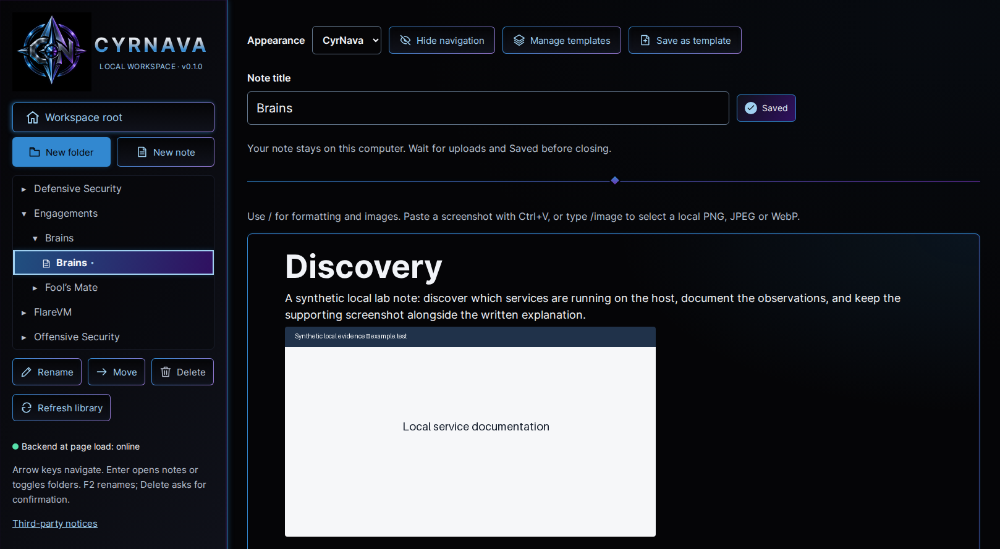

# CyrNava desktop branding and visual implementation

Date: 2026-10-29. Scope: the supplied Desktop Branding, Theme & Visual Implementation Directive V2.0. No commits, pushes, installation into the owner's desktop, live-profile changes or repository migration were performed.

## A. Implementation summary

Added **CyrNava** as an opt-in fourth appearance alongside Light, Dark and System. Its workspace follows the supplied reference: 368px desktop sidebar, emblem and metallic wordmark, blue/violet outlined controls, a luminous selected row, compact hierarchy, title/status row, gradient divider and near-black writing surface. Controls retain their existing actions and accessible names. Mobile layout remains usable with navigation shown or collapsed.

The original logo is copied unchanged into the application's local assets. Seven full-artwork Lanczos downsampling sizes serve the favicon, sidebar and existing Ubuntu installer. The installer replaces the known shipped placeholder while preserving configured custom artwork; an explicit icon argument always wins. Startup/supervision, local-only networking, APIs, database schema, native documents and data paths are unchanged. No dependencies were added or upgraded.

## B. Created and modified files

Paths are relative to the repository root.

| File | Responsibility / reason |
|---|---|
| `.gitignore` | Explicitly permit only the eight application-owned branding PNGs; continue excluding user assets/captures and test output. |
| `README.md` | Document the fourth theme, its preference key, original default logo and pinning behavior. |
| `CHANGELOG.md` | Record the scoped theme/branding update. |
| `CYRNAVA_VISUAL_REPORT.md` | This implementation, palette, comparison, validation and handoff record. |
| `desktop/generate_icons.py` | New developer utility using existing Pillow to retain original bytes and downsample complete artwork. |
| `desktop/install.py` | Select the original 512px logo by default; identify old placeholders by bytes, retain custom icons, preserve the existing launcher installation. |
| `desktop/icons/README.md` | Logo provenance/hash, icon sizes, regeneration command and legacy-placeholder explanation. |
| `docs/desktop-launcher.md` | Update logo/install/pinning guidance and explain Firefox window identity. |
| `backend/tests/test_desktop.py` | Verify canonical logo hash, exact Lanczos pixels at seven sizes, both old placeholders, custom artwork and explicit override. |
| `frontend/index.html` | Local 16/32px PNG favicons and 128px touch icon. |
| `frontend/public/assets/appearance-init.js` | Apply CyrNava's dark scheme and skin attribute before React renders, without inline scripts or remote assets. |
| `frontend/public/assets/branding/DesktopLogo.png` | Unchanged canonical owner asset, 1254 × 1254 RGB. |
| `frontend/public/assets/branding/cyrnava-16.png` | 16 × 16 favicon/desktop asset. |
| `frontend/public/assets/branding/cyrnava-32.png` | 32 × 32 favicon/desktop asset. |
| `frontend/public/assets/branding/cyrnava-48.png` | 48 × 48 desktop scaling asset. |
| `frontend/public/assets/branding/cyrnava-64.png` | 64 × 64 desktop scaling asset. |
| `frontend/public/assets/branding/cyrnava-128.png` | 128 × 128 touch/desktop asset. |
| `frontend/public/assets/branding/cyrnava-256.png` | 256 × 256 sidebar source, displayed at 128 CSS pixels on desktop. |
| `frontend/public/assets/branding/cyrnava-512.png` | 512 × 512 default Ubuntu launcher icon. |
| `frontend/src/cyrnavaTheme.ts` | Central palette, Mantine theme/CSS-variable resolver and supported BlockNote theme object. |
| `frontend/src/cyrnava.css` | Scoped reference layout, surfaces, gradients, glow, focus, status and responsive writing presentation. |
| `frontend/src/appearanceContext.ts` | Small context for branded-skin selection and editor appearance type; no editor internals exposed. |
| `frontend/src/appearance.tsx` | Add selectable CyrNava; use Mantine's color-scheme-manager contract, persisted skin selection and cross-tab synchronization. |
| `frontend/src/appearance.test.tsx` | Add branded persistence/bootstrap/storage-event coverage and extend blocked-storage behavior; retain existing appearance tests. |
| `frontend/src/main.tsx` | Load the scoped CyrNava stylesheet after existing styles. |
| `frontend/src/styles.css` | Shared logo/icon sizing and a neutral title-row wrapper while retaining existing themes. |
| `frontend/src/App.tsx` | Logo/wordmark composition and local decorative glyphs; forward the selected editor appearance without remounting it. |
| `frontend/src/components/Icon.tsx` | Small local SVG interface glyphs, hidden from assistive technology; never substitutes for the logo. |
| `frontend/src/components/DirectoryTree.tsx` | Replace the note's text glyph with the local icon; preserve tree logic/keyboard behavior. |
| `frontend/src/components/PersistentNote.tsx` | Group title/status for layout, add non-color status glyphs and forward appearance; autosave logic unchanged. |
| `frontend/src/components/KnowledgeEditor.tsx` | Apply the supported custom theme and explicit dark BlockNote context to editor and floating portal roots; document/upload behavior unchanged. |
| `frontend/src/components/KnowledgeEditor.test.tsx` | Extend the public-boundary mock to include BlockNote's newly used exported context. |
| `frontend/e2e/workspace.spec.ts` | Add synthetic reference-view/contrast/menu/mobile/restart verification; exercise all exposed editor actions under CyrNava. |
| `docs/screenshots/cyrnava.png` | Verified 1618 × 889 application-view capture with equivalent synthetic content. |
| `docs/screenshots/cyrnava-dialog.png` | Themed native template dialog capture. |
| `docs/screenshots/cyrnava-menu.png` | Themed BlockNote slash-menu capture. |
| `docs/screenshots/cyrnava-mobile.png` | 390px-wide responsive, collapsed-navigation capture. |

The supplied example includes note/evidence content. It and the side-by-side comparison were kept outside the repository; only synthetic application screenshots were added. Historical milestone/rebranding reports were not rewritten.

## C. Actual palette

The supplied base colors are unchanged. Additional semantic/border colors provide readable statuses and identifiable controls. CSS gradients/shadows also use translucent forms of the supplied blue/violet and black, not a separate color scheme.

| Role | Hex |
|---|---|
| Primary background | `#050507` |
| Secondary background | `#10121B` |
| Elevated surface | `#191D2A` |
| Blue | `#3288D0` |
| Deep blue / selection | `#205080` |
| Light blue / focus / links | `#A0D0F0` |
| Violet | `#7030B0` |
| Deep violet / selection | `#301060` |
| Metallic silver | `#A8B8C8` |
| Primary text | `#F2F4F8` |
| Secondary text | `#B8C0D0` |
| Muted text | `#929BAE` |
| Control border | `#64788E` |
| Accessible violet control border | `#9876D0` |
| Error text | `#FFADB8` |
| Warning text | `#F4D58A` |
| Online status | `#56E0AA` |
| BlockNote hover surface | `#20314A` |
| Additional Mantine dark-scale intermediates | `#36465B`, `#273247`, `#090B12` |
| Shadow | `#000000` |

Mantine's ten dark shades are defined centrally in `cyrnavaTheme.ts`, using the existing palette and those three intermediates. BlockNote's syntax highlighting and user-applied document colors remain owned by the existing editor implementation. Ordinary paragraphs and headings remain near-white. The primary blue button uses dark text for contrast. The brighter violet border is intentional: the supplied dark violet alone is too dim for a required control boundary on black. Neither refinement changes the original logo.

## D. Theme architecture and execution

1. The existing local, render-blocking `appearance-init.js` reads the standard preference and optional branded-skin key before React/CSS paint. CyrNava resolves to dark and sets `data-cyrnava-theme=true`.
2. `AppearanceProvider` keeps the existing `engage.appearance.v1` key/values (`light`, `dark`, `auto`). The new `cyrnava.theme.v1=cyrnava` flag records only the additional skin. Choosing CyrNava does not overwrite the previous standard preference. Choosing a standard option removes the flag and saves that option normally. Unknown skin values are inactive; storage failure permits a current-page choice but prevents persistence. Existing browser drafts/navigation keys remain unchanged.
3. Mantine remains responsible for color-scheme resolution, system changes and its provider. The small manager adapter maps an active branded skin to dark and synchronizes both preference keys across tabs. Mantine receives the central theme and CSS-variable resolver only while CyrNava is active. React's layout effect keeps the root skin attribute in sync.
4. `App` passes an editor appearance name through `PersistentNote`; it never imports BlockNote theme types. The dedicated `KnowledgeEditor` translates CyrNava into a supported `Theme` object and exported `BlockNoteContext` dark preference. BlockNote applies those values to its editor and portal roots, including slash/image/formatting menus. This avoids depending solely on outer CSS inheritance, which does not reliably theme floating UI.
5. `cyrnava.css` handles the native shell/controls/dialogs, scoped to the active skin. It adds static gradients and small shadows with no new animations, image filters or remote fonts. Mantine/BlockNote keep their supported component behavior and document highlights. The existing local Inter font is bundled.

Theme changes do not change the editor key, invoke a document replacement, write note data or reset autosave. Browser tests retain the same editor DOM node through all four options and compare the complete saved note, including revision, before/after switching. Writing still follows the existing BlockNote → React autosave → local API → SQLite flow.

## E. Existing Ubuntu launcher and installation

The existing `.desktop` integration already fulfills the required lightweight architecture. It starts/reuses the verified loopback worker, opens Firefox, coordinates repeated launches, and stops only its own worker. This task changes icon selection, not process supervision. Desktop IDs, installed program paths, profile paths and logging locations remain stable. Earlier installed releases remain retained by the existing installer.

After review, wait for Saved/uploads, close app tabs and use **Stop CyrNava**. From the updated checkout with the pinned Node/npm environment available:

```bash
cd "$HOME/Documents/Codex/2026-10-21/role-act-as-an-implementation-partner/outputs/CyrNava"
nvm use
python3.12 desktop/install.py --port 8000 \
  --icon "$PWD/frontend/public/assets/branding/cyrnava-512.png"
```

Retain the existing custom XDG environment and port if different. The explicit icon selects the supplied emblem even if an older custom icon is configured. The installer may need internet for pinned dependencies/build; normal use requires none. It verifies a temporary synthetic profile before updating its program copy. It never copies/moves/initializes the real profile as part of installation.

Open Ubuntu's application menu, find **CyrNava**, right-click and choose **Add to Favorites / Pin to Dash**. If an existing Desktop folder receives an icon, GNOME may require **Allow Launching**. These owner desktop actions were not executed from this session. The pinned CyrNava launcher displays its logo; the opened Firefox window retains Firefox's application/window identity. We did not force a window-class match that would group unrelated Firefox windows, introduce a separate browser profile, or add a desktop framework.

## F. Visual comparison



Reference metadata: supplied `Example.png`, 1680 × 936, SHA-256 `ddd1436e2fda23635bbfa5d046189562a03b68ffd85444df62f6b4753d13d79a`. Canonical logo SHA-256: `0d5be626f349f83cde2dc0738242e7cccf13ed7b08c08ab85b6d6853fa69db24`.

Executed comparison procedure:

- Ran the real static frontend/FastAPI against a temporary SQLite profile and local image storage. Seeded an equivalent hierarchy, H1 heading, paragraph and synthetic screenshot through existing APIs.
- Selected CyrNava with OS light mode, ensuring the selected theme controls the result.
- Captured both a 1680 × 936 viewport and a 1618 × 889 viewport at device scale 1 and default 100% zoom. The latter matches the reference's application region after excluding its 62px browser rail and 47px top chrome.
- Created and visually inspected a side-by-side comparison of that reference crop and the 1618 × 889 app capture. The comparison is outside Git in the task's `work/cyrnava-visual-comparison.png`, so the reference's note/evidence is not committed.
- Corrected initial differences: title row width, root-button alignment, first-row button sizing, editor top padding, wordmark proportions, menu capture timing and mobile heading size. Rebuilt, recaptured and compared again.
- Visually inspected the native template dialog, BlockNote slash menu and the 390px mobile capture. The palette applies to the floating menu rather than inheriting the original light system preference.

The final desktop layout uses a 368px sidebar, 20px sidebar padding, 32px main horizontal padding, an 888px maximum title/status row, 54px title input, approximately 46px toolbar controls, a 1px divider/editor border, 52px H1 and 18px body writing. The mobile H1 becomes 36px. Main content, divider and editor placement closely follow the reference.

Remaining differences are explicit: Firefox/browser chrome is outside the app's control; live text uses local Inter rather than an unavailable custom wordmark font; small interface icons are local outline SVGs; the authoritative logo retains its original black background and detailed artwork rather than being extracted from the reference; synthetic note/image content differs; brighter accessible borders and primary-button text differ slightly from the reference. This is a verified comparison, not a claim of pixel identity or a measured similarity percentage.

## G. Testing

Final results are recorded below after execution. Tests use temporary profiles and browser contexts; no personal database, screenshots, templates, credentials or normal browser profile were targeted.

| Check | Result |
|---|---|
| Full backend pytest suite | **228 passed**, one existing Starlette/httpx deprecation warning. |
| Desktop tests within that suite | **16 passed**, including repeated launch, unrelated-port safety, state/profile persistence and logo validation. |
| Extended original-logo selection test | Passed again after adding coverage for the older ENGAGE placeholder. |
| Full frontend Vitest suite | **210 passed**, 19 files. |
| Updated appearance/adapter checks | Passed; persistence, blocked storage, startup bootstrap, cross-tab sync, standard themes and editor identity retained. |
| TypeScript and ESLint | Passed. |
| Ruff lint/format | Passed, 29 files. |
| Production Vite build | Passed; preexisting large-bundle warning remains. |
| Full Chromium static-release Playwright suite | **9 passed**, including the two managed lifecycle journeys and all editor actions under CyrNava. |
| Firefox workspace appearance/navigation/template/reference journeys | **3 passed**, exit code 0. An earlier combined run printed 5 passed (including lifecycle) but ended with outer exit 143; it was not treated as a clean run. |
| Separate Firefox managed lifecycle journeys | **2 passed**, exit code 0, against the final build. Together with the clean workspace rerun, all five selected Firefox journeys completed successfully. |
| Git whitespace and branding asset exclusion checks | Passed; only the explicit eight branding assets are allowed, unrelated uploads remain ignored. |

The reference journey verifies real editing/autosave after a backend restart, local image display without a filter, all four appearance options without editor remount or saved-data changes, persisted CyrNava selection after reload, a themed native template dialog and slash menu, representative computed text contrast, every visible enabled button's text contrast, and mobile layout without horizontal overflow. External requests are rejected and the recorded external-request list must remain empty. The full release suite additionally covers templates/custom images, folder CRUD/movement, keyboard access, conflicts, outages, backup/restore and native formatting.

During implementation, tests caught an incorrect Mantine prop name and showed that forcing the color scheme blocked the normal setter when leaving CyrNava. The final implementation uses Mantine's supported manager contract instead. The adapter test mock needed the newly used public BlockNote context. Ruff also caught two long lines. These were corrected before the passing runs; no test expectations were weakened to conceal a product failure.

The final Chromium reference journey also passed separately after making its synthetic text-selection setup deterministic. That adjustment removes the slash-command query before typing its final fixture paragraph; it changes test input setup, not product behavior.

The earlier outer exit 143 was not reproduced in either separate Firefox run; its cause was not established. No launcher/process-termination changes were made to mask it. The final full frontend suite, lint/type checks, build and separate Firefox lifecycle run also passed after the last status-icon adjustment.

Accessibility checks target WCAG AA for measured controls/text. They are not a full WCAG or screen-reader certification. Native file dialogs, real GNOME pinning/cache/trust behavior, and the owner's everyday profile remain manual checks. Syntax highlighting uses the existing dark editor implementation; exhaustive contrast for every syntax token and every user-selected color is not claimed.

## H. Git handoff

Suggested commit: `feat: add CyrNava theme and original desktop branding`.

Review the source, synthetic screenshots and install command before updating the installed copy. No commit/push, real desktop installation, profile migration or unrelated product feature was performed. The pending project-license decision is unchanged.
