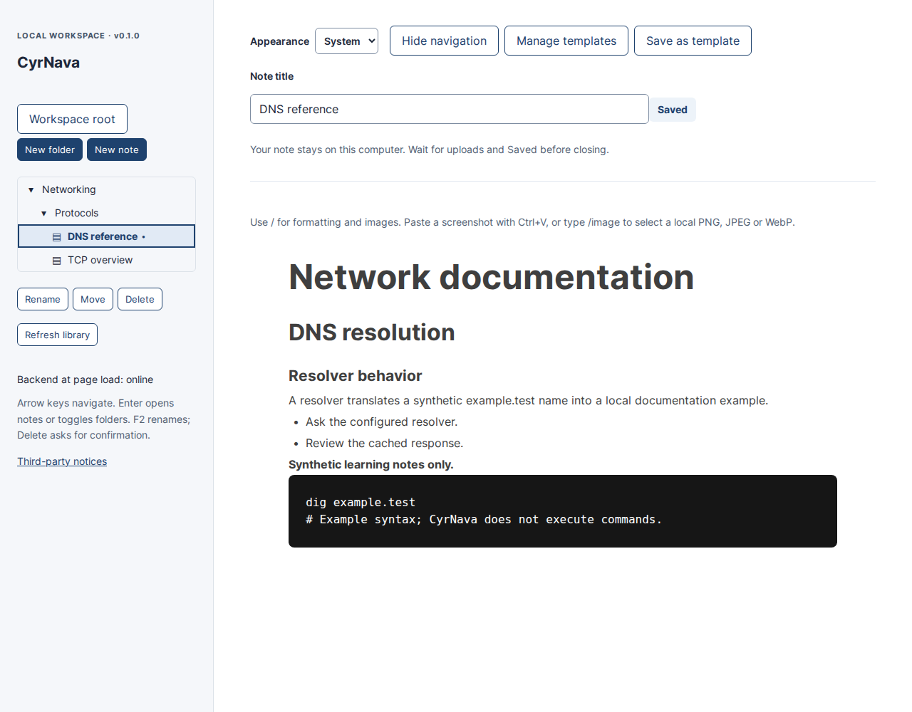
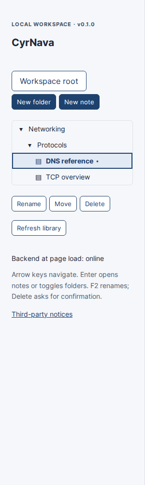
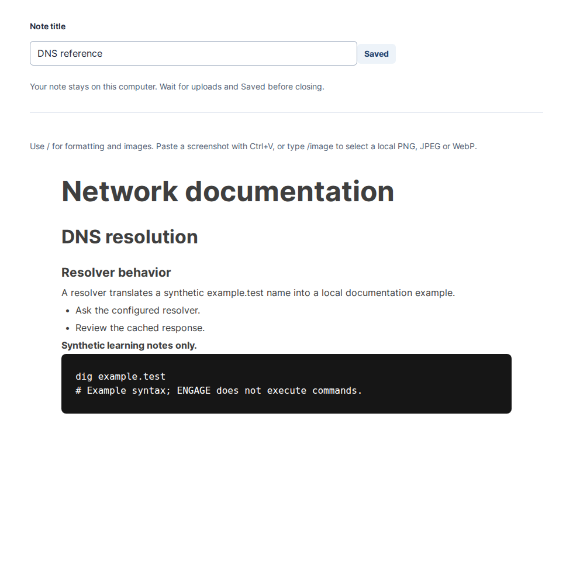
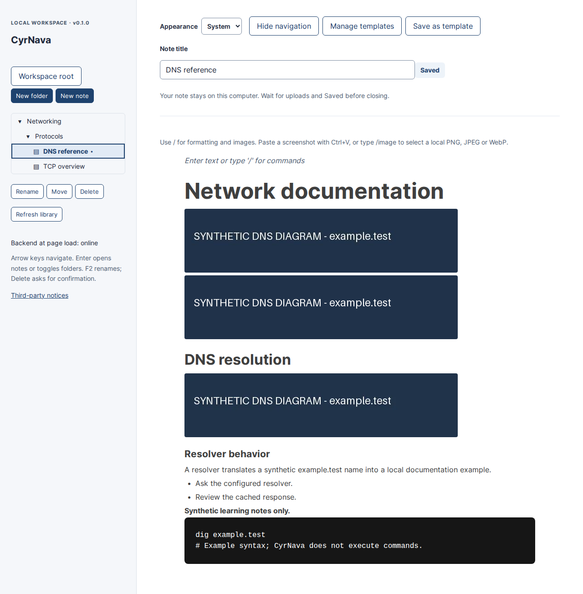

# ENGAGE — Pentest Engagement Manager

**v0.1.0 release candidate · Phase 1 local knowledge workspace · Linux**

ENGAGE organizes cybersecurity learning and documentation into folders and rich-text notes on your computer. SQLite stores native documents and templates; local files store note images. There are no runtime accounts, cloud services or external API calls. Engagement, host and vulnerability management are future work, not current features.

**Release approval and the original-code license are pending.** This checkout is a review candidate, not an announced public release. See [release checklist](docs/release-checklist.md).

## Features

- Two-pane workspace with nested folders, notes, rename, move and confirmed deletion.
- Keyboard tree navigation and a dedicated BlockNote editor supporting headings, paragraphs, lists, checkboxes, quotes, inline formatting and plain code blocks.
- Persistent clipboard screenshots and PNG/JPEG/WebP uploads.
- Debounced autosave, visible status, stale-revision protection and deliberate conflict recovery.
- Local SQLite/filesystem persistence and verified offline backup/restore.
- Collapsible navigation with a browser-local preference, preserving the open editor and pending edits.
- Five built-in pentesting note templates plus reusable custom templates with independent screenshot copies.

## Navigation and templates

Use **Hide navigation** above the editor to give the note more space; **Show navigation** stays available in the same place. The button supports keyboard activation and remembers the preference for this browser origin. Collapsing does not reload the note or trigger a save. Autosave continues normally. If browser storage is unavailable, the control still works for the current page.

**New note** still defaults to **Blank note**. Choose a template under **Starting content** for General Penetration Testing, Enumeration, Exploitation, Privilege Escalation, or HTB / TryHackMe Lab notes. The selected folder is used exactly as for a blank note. Templates contain headings, empty paragraphs and, where appropriate, empty code blocks; ENGAGE never executes their contents.

To reuse your own structure, open the source note, choose **Save as template**, enter a name and save. Pending uploads and edits must save successfully first. The template captures that confirmed revision, including its formatting and independent image snapshots. Creating another note gives it new block IDs and new owned image files. Later edits or deletion of the source note, template, or another generated note do not change the others.

**Manage templates** lists all templates and allows custom rename/delete with deletion confirmation. Built-ins cannot be renamed or deleted. To change a custom template's content, create a new template from an edited note, then optionally delete the old one. Names need not be unique. A custom template supports up to **50 MiB total copied images**; existing per-image and document limits still apply. Failures stay visible and do not create partial notes/templates.

Custom templates are private application data in the existing external SQLite database, included in offline backup/restore. The first start of this code adds schema version 4; it does not rewrite existing notes or assets. Before upgrading an everyday profile, stop ENGAGE and take a backup using [BACKUP_RESTORE.md](BACKUP_RESTORE.md). Older application code cannot open schema 4: keep a pre-upgrade backup if rollback may be needed. See the [FF-006 / FF-018 engineering report](FEATURES_FF006_FF018_REPORT.md) for implementation and verification details.

## Screenshots

These are real browser captures of an isolated synthetic workspace; no personal notes or operational evidence were used.



| Hierarchical library | Formatted documentation |
| --- | --- |
|  |  |



## Architecture

React and TypeScript implement selection, dialogs and save state. A dedicated adapter isolates BlockNote APIs. Vite builds the frontend; FastAPI validates local HTTP requests. SQLite owns durable documents, relationships and revisions; an application-owned asset directory stores validated raster images. The supported release launcher serves the built frontend and API from one loopback origin.

Read [architecture and three execution flows](docs/architecture.md), [ADRs](docs/adr/README.md), and [dependency/license review](docs/dependencies-and-licenses.md).

## Prerequisites

Target setup: Ubuntu 24.04, Python **3.12**, Node **24.19.0** (`.nvmrc`), npm **11.6.2**, Git. Verification used Linux with Python 3.12.14 and Node 24.19.0; it did not use a fresh Ubuntu VM. Other OSes are unverified; profile locking uses Linux `fcntl`.

```bash
sudo apt update
sudo apt install -y git curl ca-certificates python3.12 python3.12-venv
```

Install Node separately. If using **nvm** (a shell-based Node version manager, not an apt package), follow its [official installation instructions](https://github.com/nvm-sh/nvm#installing-and-updating), then reopen your terminal. An existing matching Node/npm installation also works.

## Installation

From a fresh terminal:

```bash
git clone https://github.com/74Cerillion/PEngage_Pentest-Engagement-Manager-.git engage
cd engage
nvm install
nvm use
npm install --global npm@11.6.2
python3.12 -m venv backend/.venv
backend/.venv/bin/python -m pip install -r backend/requirements.txt
cd frontend
npm ci
npm run build
cd ..
```

Skip the three nvm/npm setup commands if those versions are already installed. Dependencies are isolated in `backend/.venv` and `frontend/node_modules`. Installation/browser setup downloads packages; normal operation needs no internet. Python dependencies are fully pinned in `requirements.txt`; npm uses `package-lock.json`. The final M6 commit must be published by the owner before a public clone contains these M6 changes. [Verification](M6_VERIFICATION.md) distinguishes the public M5 clone from the clean M6 candidate export.

## Install a desktop launcher (Ubuntu)

For everyday use, prepare a launcher once from the source checkout. This builds the frontend and installs a private Python environment. Node/npm are needed only for this installation and later source rebuilds; the desktop launch does not use npm, nvm or Vite.

```bash
sudo apt update
sudo apt install -y git curl ca-certificates python3.12 python3.12-venv xdg-utils xdg-user-dirs zenity firefox
```

Install Node **24.19.0** and npm **11.6.2** for the one-time build. If using nvm, follow its official install instructions, reopen the terminal, then:

```bash
nvm install
nvm use
npm install --global npm@11.6.2
python3.12 desktop/install.py
```

Run from the repository root of a source checkout that contains `desktop/install.py`; a clone of a branch or tag from before P2-M01 cannot install the launcher. The installer creates `$XDG_DATA_HOME/engage-application/` (normally `~/.local/share/engage-application/`) for program files, a per-user Python environment, and menu entries; logs are in `$XDG_STATE_HOME/engage-launcher/` (normally `~/.local/state/engage-launcher/`). Your existing database and screenshots stay in `$XDG_DATA_HOME/engage/` (normally `~/.local/share/engage/`). It does not copy, move, initialize or delete that profile. If you normally use a custom `XDG_DATA_HOME`, set the same value for installation; the launcher records it so graphical startup uses that profile.

ENGAGE appears in the application menu and, if an existing XDG Desktop folder is detected, as a desktop icon. GNOME may show **Allow Launching** when you first click the desktop icon; review and approve the entry in the file manager if prompted. This is a desktop trust decision. No OS security setting is disabled. The shipped icon is a temporary placeholder; the owner-approved logo can be installed with `python3.12 desktop/install.py --icon /absolute/path/approved.png` (SVG is also supported).

The initial install downloads pinned dependencies and builds static files. Keep network available until it reports success. If startup fails, ENGAGE shows an error; choose **Open diagnostic logs** in the app menu or inspect the two log files above. Normal desktop launches open Firefox and automatically stop the owned backend after the last ENGAGE tab's lease ends and a 5-second grace elapses. Heartbeats run every 5 seconds and expire after 20 seconds; startup registration has 60 seconds. The **Stop ENGAGE** action remains a fallback. Wait for **Saved** and image uploads before closing. Stop a running development server first if it already owns the configured port. A different local port can be selected during install with `--port 18000`.

To update, wait for Saved, choose Stop ENGAGE and run `python3.12 desktop/install.py` again from the updated checkout. It builds a new version under the application directory, checks it with a temporary profile, then updates the menu entry. Old application releases remain for rollback; they contain no user data. Re-running the installer does not duplicate launchers or reset the profile. There is no automatic update. To remove the launcher, delete its `org.engage.Workspace.desktop` and `org.engage.Stop.desktop` entries from the application directory and Desktop folder, then remove `engage-application/` and `engage-launcher/` under the same XDG locations. **Do not remove `engage/`** unless you separately intend to delete your notes and images. Back up first.

See [desktop launcher details and troubleshooting](docs/desktop-launcher.md).

### Developer/server mode

Developers can continue to run the two-server Vite workflow below. It is not needed for normal graphical launch.

### Local release mode (one server)

After building, from the repository root:

```bash
cd backend
.venv/bin/python -m app
```

Open **http://127.0.0.1:8000**. FastAPI serves the bundled frontend and API; Vite is not running. Stop with Ctrl+C. For another port use `.venv/bin/python -m app --port 8010`. This launcher always binds `127.0.0.1`. It is for local use, not public internet hosting. Rebuild after frontend source changes.

### Development (two terminals)

```bash
# Terminal 1, from the repository root
cd backend
.venv/bin/python -m uvicorn app.main:app --host 127.0.0.1 --port 8000 --reload
```

```bash
# Terminal 2, from the repository root
cd frontend
npm run dev
```

Open **http://127.0.0.1:5173**. Vite forwards `/api` to FastAPI. Start each service once. If a port is occupied, inspect `ss -ltnp 'sport = :8000'` (or `:5173`); an existing ENGAGE server may already be running. Stop the identified server in its terminal before restarting. Do not kill an unidentified process. Alternate dev ports: set `ENGAGE_API_PORT=8010 npm run dev -- --port 5185` and start Uvicorn with `--port 8010`.

## Usage

1. Select **Workspace root**, then **New folder**. Select a folder before creating a child folder or note. Selecting a note makes new items its siblings.
2. Select **New note**, enter a title and edit. Click notes in the tree to reopen them. Folder arrows expand/collapse; labels select.
3. Type `/` for formatting, or shortcuts such as `# ` for H1 and `## ` for H2. Code blocks display text and never execute it.
4. Paste a screenshot with **Ctrl+V**, or type **/image**, choose Image, then **Upload image**. Static PNG, JPEG and WebP only: 10 MiB, 8192 pixels per side, 20 million pixels total. File drag-and-drop and external image URLs are disabled.
5. Use **Rename**, **Move**, or **Delete** on the selected tree item. Moving supports Workspace root. Folder deletion shows descendant counts and requires confirmation; cancellation removes nothing.
6. Wait for uploads to finish and **Saved** before closing. **Unsaved Changes**, **Saving…**, and **Save Error** describe pending/failed work. Retry a failed save; a conflict requires review and retaining the downloaded recovery JSON before explicitly reopening saved content. Save errors block note switching and management transitions.

With tree focus: Up/Down traverse visible items; Right expands/enters; Left collapses/returns to parent; Home/End select focus endpoints; Enter opens/toggles; F2 renames; Delete asks for confirmation. Escape cancels an idle dialog. Editor keys stay inside the editor. The skip link goes directly to the main editor area. **Refresh library** retrieves changes from other tabs; there is no continuous synchronization.

## Local data storage

- Absolute `$XDG_DATA_HOME`: `$XDG_DATA_HOME/engage/engage.sqlite3` and `$XDG_DATA_HOME/engage/assets/`.
- Otherwise: `~/.local/share/engage/engage.sqlite3` and adjacent `assets/`.

Relative XDG values are ignored. Runtime data inside this checkout is rejected. New directories/files use 0700/0600 permissions. Library folders are SQLite records, not disk directories. The browser remembers a preferred note ID and per-tab recovery copies of unconfirmed edits. SQLite remains authoritative. Changing port/origin or clearing browser storage does not delete saved notes, but can make recovery drafts unavailable. Notes, assets and browser drafts are **unencrypted**. Localhost does not protect against other software running as your user.

## Backup and restore

Read [BACKUP_RESTORE.md](BACKUP_RESTORE.md) before handling real data. Wait for Saved and uploads, stop **all** backends, choose private absolute paths outside Git with existing parents, then from `backend/`:

```bash
.venv/bin/python -m app.backup backup --destination /private/backups/new-workspace.engage-backup
.venv/bin/python -m app.backup restore --source /private/backups/new-workspace.engage-backup --data-dir /private/restored/engage
XDG_DATA_HOME=/private/restored .venv/bin/python -m app
```

These example paths must be replaced with your private locations. Existing destinations are refused. Restore into a new profile and verify its notes/images. Backups and recovery downloads contain private unencrypted data; never commit them.

## Testing

From `backend/`:

```bash
.venv/bin/python -m pytest -q
.venv/bin/python -m ruff check .
.venv/bin/python -m ruff format --check .
.venv/bin/python -m pip check
```

From `frontend/`:

```bash
npm run lint
npm test
npm run build
npx playwright install chromium
npm run test:e2e
npm run test:release
```

On minimal Ubuntu, `npx playwright install --with-deps chromium` also installs browser system libraries. Browser installation is development tooling, not an application runtime dependency. Tests create temporary profiles, launch their own loopback servers and clean up. They never target your personal profile. Build before `test:release`. See [M6 verification and T-01–T-12 matrix](M6_VERIFICATION.md).

## Known limitations

Unsaved title/document edits have browser-local recovery snapshots when storage is available; failures are reported. Reopening offers recovery with the original base revision, preserving conflict checks. Browser storage deletion/private browsing/storage failure can still lose drafts, and in-flight image files must be reselected if closed before upload completes. There is no automatic merge, authentication, encryption, live backup or multi-user support. Removed image blocks retain owned files until note deletion. Image normalization removes metadata and recompresses JPEG: ENGAGE is not forensic-original evidence storage. Cross-note image blocks must be re-uploaded. Screen readers and full WCAG conformance are unverified. See the [lifecycle report](LIFECYCLE_REPORT.md) for browser verification; existing large-bundle and Starlette/HTTPX deprecation warnings remain documented.

## License

The owner has explicitly left the original-code license **pending**. No open-source permission grant is implied; package metadata says `UNLICENSED` while that decision is pending. MIT is recommended for owner review. BlockNote core uses MPL-2.0; its obligations remain separate. [Third-party notices](frontend/public/third-party-notices.txt), [Python notices](docs/python-third-party-notices.txt), and the [license review](docs/dependencies-and-licenses.md) describe dependencies, fonts and unresolved attribution verification. No BlockNote XL package is used.

## Development roadmap

Phase 1 implements the local knowledge workspace described above. M6 prepares its release candidate. Broader engagement management, search, tags, integrations and other Phase 2 work require separate owner authorization. No future release dates are promised. See [changelog](CHANGELOG.md), [release draft](docs/release-notes-v0.1.0.md), and [M6 engineering report](M6_REPORT.md).
