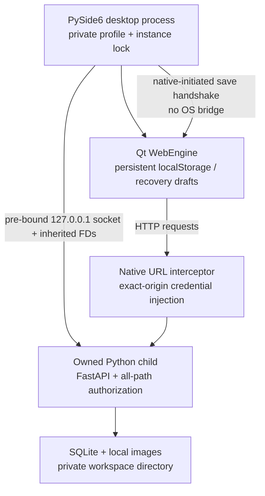

# CyrNava P2 — Desktop integration and security assessment

**P2 STATUS: ACCEPTED — FINAL NATIVE PORTAL VERIFICATION PASSED**

Accepted 30 October 2026 (Asia/Seoul). Owner-executed run `run-64a7b56d5fc0`
was independently verified from both final JSON records. Corrected driver
`p2-portal-window-filter-3`, source SHA-256
`d4e5025c567074f7dc653b265e3429c2979e6bc5c70f0c9c6775fab251d8089b`,
matches current source. Supervisor and driver report complete PASS, child exit 0,
stage finished, and no remaining child. All eight checks passed, including the
real native Save chooser, granted-file JSON readback, offline recovery-draft
export, explicit recovery close, and owned-backend reaping. The driver record
sets `real_save_portal: true`; this was not a mocked export destination.

Original evidence:
`/home/cerillion/.var/app/org.cyrnava.CyrNava.Devel/data/p2-portal-verification/run-64a7b56d5fc0/`.
Repository copies: `desktop/native/evidence/p2-final-2026-10-30/`.
Prior failure/investigation sections below are retained as historical evidence;
their pending/conditional statuses are superseded by this acceptance record.
This passing run supports the instrumentation correction, without claiming a
native C++ stack established the exact earlier segmentation-fault mechanism.


Date: 29 October 2026 (Asia/Seoul). Branch: `desktop/p2-production-integration`.
Native verification update: 30 October 2026 (Asia/Seoul).
Repository: `/home/cerillion/Documents/Codex/2026-10-21/role-act-as-an-implementation-partner/outputs/CyrNava`.

**Latest investigation, 30 October 2026:** P2 remains conditionally accepted.
Owner run `run-f7703fae217f` confirms a native SIGSEGV during startup, before the
portal workflow. The supervisor records FAIL correctly. The test helper's
application-wide event-filter registration is now corrected to main-window-only,
revision `p2-portal-window-filter-3`; native confirmation is pending. See the final
section. Production application behavior and sandbox permissions are unchanged.

## Assessment status

P2 implementation is present alongside the Firefox launcher. The owner built the
isolated native Flatpak and executed all four native verification phases
successfully. Their JSON results were independently read, and the installed
application/worker/security/storage/frontend/test-driver source hashes were
compared with working source before the latest corrections. Renderer isolation,
authenticated frontend and images, actual Qt input, immediate close/save,
persistent preferences, restart, owned-backend reaping, Keep open, explicit
recovery close, offline JSON export and recovered SQLite persistence passed.

**P2 is not declared fully approved.** Manual testing exposed two defects:
the close-status paragraph disturbed the workspace grid, and the real image
portal was initialized with the Flatpak-only `/app/share/cyrnava` directory. Both
are corrected in source. The layout regression now passes in a real browser;
chooser contract tests pass. On the rebuilt candidate, the owner confirmed real
image selection/upload, save, close, application restart and preserved content
(29 October, approximately 22:09 Asia/Seoul). The installed shell, chooser helper
and frontend index matched source/build bytes at that inspection. The owner has
since confirmed real screenshot clipboard paste and persistence. Both native
held-upload/layout and restart drivers also passed, with their JSON results
independently read. On the rebuilt 30 October candidate, the owner confirmed that
notices display their actual text and the external-link action does nothing; the
recording shows the workspace remaining open without a blank popup. That native
check is now PASS. The real export drill remains a conditional acceptance gate.
One historical native portal run (`run-91ae16058f20`) reports complete PASS, but
later runs (`run-7e68d60e8c21`, `run-baf4cc679f64`) fail before the chooser at
`typed`. The original native-close origin is not established by their evidence.
The current driver-only serialization and close-trace correction is detailed in
the final investigation below. It requires one owner-executed real Save portal
and JSON readback run. No unexpected dialog is suppressed or accepted as success.
No general note-export feature was added; recovery JSON download is offered only
after a failed note save. The existing Save icon is status feedback.
No P3–P6 implementation, real-data migration, public release, remote publication,
signing-key creation, Git commit or push occurred. The Firefox installer/launcher
and existing P1/P1B sources were preserved.

## Architecture and execution flow



`application.run()` validates the Flatpak identity, permission context and WebEngine
settings. `Profile` establishes an owned, private root and exclusive instance
lock. `Backend.start()` binds only `127.0.0.1`, reuses the previously selected port,
starts `worker.py` through a retained `Popen`, and sends its fresh credential through
an anonymous inherited pipe. The worker retains the instance-lock descriptor,
constructs `DesktopSession` and `create_app(..., desktop_session=...)`, and runs
Uvicorn on the inherited socket. An authenticated existing health route establishes
readiness within 20 seconds. No new readiness/debug HTTP endpoint was added.

The GUI opens the built React frontend through this server. `Interceptor` attaches
the session header only to the exact origin and refuses resources after its owned
backend dies. Own-origin in-memory blob exports remain usable during an outage
and never receive session credentials. Navigation permits the application root; a bounded popup preserves
the existing third-party notices link. External URLs, file URLs, other ports,
ordinary popups, plugins, screen capture and requested web permissions are denied.
After the observed blank-popup defect, window requests now use Qt's
`newWindowRequested` destination before allocating a widget. Only a user-initiated
request for the same-origin notices path creates a page; rejected requests create
no window. The notices page retains its own navigation restriction. This uses
[Qt's new-window request API](https://doc.qt.io/qtforpython-6/PySide6/QtWebEngineCore/QWebEngineNewWindowRequest.html)
and does not enable JavaScript popup settings or launch external browsers.
There is no arbitrary native JavaScript/command/filesystem bridge. JSON blob draft
exports use a native save chooser with the existing portal platform integration.
Both image selection and draft export explicitly start at the host-visible home
folder; editor-supplied previous paths and the application's /app working directory
are not used as initial chooser locations. Image selection supports one/multiple
PNG, JPEG or WebP files; directory selection is rejected. These are user-mediated
Qt dialogs, with no broad home grant or native command bridge.

A paragraph travels through BlockNote's public `onChange` boundary in
`KnowledgeEditor`, `useAutosave.changeDocument`, synchronous recovery journaling,
and serial debounced PATCH requests through `http.request`. The existing SQLite
revision transaction commits before FastAPI responds. Autosave acknowledges only
the submitted version; newer edits remain dirty. Loading reverses this flow using
the existing tree/note endpoints and the saved native JSON document. No Markdown
or HTML conversion or database schema change was introduced.

### Normal close and failure choices

`Window.closeEvent()` generates a request ID and invokes the frontend's narrow
`window.__cyrnavaDesktop.request(id)` contract. `useDesktopClose` freezes input,
waits for tracked HTTP mutations, and calls the current note's `flush()`. That
first drains the complete accepted multi-image paste/upload sequence, verifies
that no image block lacks a durable URL, then drains serial autosave. Native
polling accepts only this request ID's `saved` acknowledgement. Older/cancelled
attempts cannot approve a later close.

A pending management form is not silently discarded. Save/upload failure, an
unresolved recovery choice, a missing protocol or a 45-second native deadline
produces an explicit dialog. **Keep open** is the default and unlocks the frontend;
**Close with recovery draft** explicitly accepts the risk of unconfirmed work.
Failed note saves also offer **Download pending draft**, using the current title,
JSON and revision even if browser recovery storage itself is unavailable.

After closure, the desktop signals and waits for its retained backend, with bounded
SIGKILL fallback against that child only. It destroys WebEngine pages before their
profile, then releases the instance lock. A death-pipe EOF also asks the worker to
exit if the GUI disappears; its inherited lock prevents a replacement from racing
that worker. No saved PID file is used to kill processes. Startup failure reaps its
child and closes the socket. A second launch explains that the profile is open;
it does not activate the old window or create another backend.

Limits: recovery JSON does not contain pending image bytes; SQLite durability is
bounded by the filesystem/device. Browser localStorage is synchronously updated
at the JavaScript boundary but is not a guaranteed power-loss journal. SIGKILL,
OS crashes, full disks, damaged profiles and compromised same-user host processes
cannot be made lossless by this close protocol. Open forms require finishing or
dismissing before normal close. Long multi-image batches can reach the deadline;
Keep open lets them continue and the owner can retry closure.

## Authorization and trust boundaries

`DesktopSession` creates a 256-bit random per-backend credential using
`secrets.token_urlsafe(32)`. It exists in native/worker memory, anonymous pipes and
native-injected request headers. It is not a URL parameter, command-line argument,
environment variable, frontend artifact, cookie, localStorage item or profile
configuration entry. Qt uses a memory HTTP cache and no persistent cookies.

`DesktopAuthorization` is installed outermost, after frontend serving, and protects
**every HTTP path**, including static files, health aliases, notes, search,
templates, folders, images and existing lifecycle routes. Missing/wrong/duplicate
credentials return 401; wrong/duplicate Host returns 400; foreign/null/duplicate
Origin, unsafe methods without Origin and cross-site fetch metadata return 403.
Only the exact numeric loopback host/port is accepted. Native readiness GETs may
omit Origin; mutations may not. No CORS allowance or proxy-header trust is added.
WebSockets are refused. Responses are no-store; exceptions do not echo submitted
note bodies or session headers. Lifespan completion and startup errors revoke the
session, and a fresh backend invalidates an old token.

Trust boundaries remain important:

- Untrusted note/image content enters the existing constrained BlockNote schema,
  API validation, image decoding/re-encoding and parameterized database operations.
- The renderer has authority to use this application's same-origin API. A renderer
  compromise can read/change the application's data; header injection is not a
  defense against a compromised trusted renderer. No OS bridge is added.
- Same-user host code can inspect/control its own Flatpak, files and processes.
  Session credentials are not a boundary against a fully compromised user account.
- The native worker and its private profile are trusted application components.
- A portal-selected file is an explicit user grant, rather than broad home access.
- The legacy Firefox/development entry points remain separately usable and retain
  their existing authorization behavior. This change hardens the **native desktop
  session**, not every manually launched legacy server.

Qt documents request interception as the API for blocking/modifying requests before
Chromium's networking stack; the implementation avoids calls back into the profile
inside the interceptor. [Qt interceptor documentation](https://doc.qt.io/qtforpython-6/PySide6/QtWebEngineCore/QWebEngineUrlRequestInterceptor.html).

## Storage and upgrade boundary

Candidate identity: `org.cyrnava.CyrNava.Devel`, branch `p2`. Its normal root is:

```text
~/.var/app/org.cyrnava.CyrNava.Devel/data/cyrnava/
├── .instance.lock
├── desktop.json              # version + stable port, no credentials
├── backend.log               # private diagnostics, access logging disabled
├── workspace/
│   ├── engage.sqlite3
│   └── assets/               # existing database-owned relative image relationships
├── web-profile/              # Qt localStorage, preferences and recovery JSON
└── web-cache/                # reserved Qt cache directory
```

The automated driver uses the separate sibling `p2-verification/` root. Neither
entry point discovers or imports the Firefox data directory. Production application
data never depends on `/tmp`; build snapshots use the XDG cache directory (normally
`~/.cache/cyrnava-builds/p2/`), while automated unit profiles use temporary directories. Packaged source under `/app` is separate and
read-only at runtime. Replacing a package does not replace these profile files.

Directories are 0700; application-created files are 0600 under umask 077. Startup
checks ownership and refuses symlinks (including path ancestors, SQLite sidecars
and Qt files), multiply linked files and unexpected special files. New private
files use `O_NOFOLLOW`; the stable port file uses write/fsync/atomic replace and
parent-directory fsync. Unsafe/corrupt initialization fails visibly rather than
silently selecting a new origin. These checks do not claim to eliminate malicious
same-user replacement races. The existing SQLite schema version 5, migration
transactions, foreign-key checks, image ownership and backup implementation remain.
Real-profile migration and rollback design/testing are P3 responsibilities.

## Files created or modified

Paths below are relative to the repository identified at the top. Existing
untracked `prototypes/` files predate P2 and are not part of this change list.

| File | Responsibility, dependencies and reason |
|---|---|
| `backend/app/desktop_security.py` (new) | Standard-library credential/session policy and Starlette ASGI authorization; all-path native protection. |
| `backend/app/main.py` | Adds explicit native-session opt-in and revocation; preserves existing routes/default Firefox behavior. |
| `backend/tests/test_desktop_security.py` (new) | Existing pytest/TestClient; positive/negative authorization, origins, aliases, images, revocation and startup failure. |
| `backend/tests/test_native_desktop.py` (new) | pytest/stdlib and real worker processes; storage, locks, startup failure, collision, death pipe, token rotation, restart and URL policy. |
| `backend/tests/test_native_dialogs.py` (new) | pytest/Mock contract checks for initial chooser directories, portal paths, multi-selection and cancellation. |
| `backend/tests/test_native_navigation.py` (new) | pytest/Mock checks that denied or automatic window requests never allocate widgets, and approved user notices requests open exactly the approved page. No Qt dependency required in the backend test environment. |
| `backend/tests/test_flatpak_candidate.py` (new) | pytest; narrow manifest, snapshot safety and direct-reference preflight regression. |
| `desktop/native/__init__.py` (new) | Independent native package; no effect on the Firefox launcher. |
| `desktop/native/__main__.py` (new) | Minimal module entry point invoking the production shell. |
| `desktop/native/application.py` (new) | PySide6 shell, navigation/interception, bounded save/close, portal downloads and environment guards. |
| `desktop/native/backend.py` (new) | stdlib subprocess/socket/pipe lifecycle plus existing Uvicorn/FastAPI; retains and reaps one worker. |
| `desktop/native/worker.py` (new) | Internal inherited-descriptor worker entry; no HTTP/debug route. |
| `desktop/native/storage.py` (new) | stdlib Linux locks and private persistent profile initialization. |
| `desktop/native/dialogs.py` (new) | Bounded user-mediated Qt image/export dialogs with explicit host-visible initial paths; Qt class injection allows testing without installing Qt in the backend environment. |
| `desktop/native/policy.py` (new) | Pure stdlib exact-origin navigation/resource/export policy, independently testable. |
| `desktop/native/requirements.txt` (new) | Explicit isolated-host Qt pins; Flatpak instead uses its matching sandbox-aware BaseApps. |
| `desktop/native/P2_REPORT.md` (new) | This review record, limitations, acceptance and P3 dependencies. |
| `frontend/src/hooks/useDesktopClose.ts` (new) | React/HTTP tracker; narrow, request-ID-bound native save handshake without a privileged bridge. |
| `frontend/src/hooks/useDesktopClose.test.tsx` (new) | Existing Vitest/Testing Library; draining, cancellation, failures, late acknowledgements and timeout. |
| `frontend/src/pendingMutations.ts` (new) | Small counter/failure generation for in-flight JSON API mutations; retains no bodies or secrets. |
| `frontend/src/http.ts` | Wraps existing JSON mutation requests so management actions participate in closure. |
| `frontend/src/App.tsx` | Registers close handshake, freezes input and drains the current operation/note; preserves the layout. |
| `frontend/src/components/KnowledgeEditor.tsx` | Tracks full accepted paste batches; checks incomplete image URLs and reports upload state through the editor boundary. |
| `frontend/src/components/KnowledgeEditor.test.tsx` | Tests incomplete images and multi-image completion after input is locked. |
| `frontend/src/components/PersistentNote.tsx` | Combines document/upload status and exports the current failed-save draft through the existing JSON download path. |
| `frontend/src/components/PersistentNote.test.tsx` | Checks upload-first flush, truthful status and failed-save export payload. |
| `frontend/e2e/workspace.spec.ts` | Real browser close/autosave/outage recovery, held image upload and unsubmitted form tests; existing helpers and synthetic profiles. |
| `packaging/flatpak/prepare.py` (new) | Isolated local review snapshot/build/install, pinned wheels, hashes/runtime commit evidence and narrow manifest; no publication. |
| `packaging/flatpak/verify_outage.py` (new) | Test-only real-Qt backend-outage/recovery drill. Default save destination remains stubbed; optional `3 --portal` uses the unchanged real production chooser and reads back only the user-selected synthetic JSON export in a separate profile. |
| `packaging/flatpak/verify_upload.py` (new) | Test-only real Qt clipboard/held asset fetch/native close/layout/SQLite/restart drill; streams into the installed sandbox, uses its installed shell and a separate synthetic profile. |
| `packaging/flatpak/test_verify_outage.py` (new) | Existing backend pytest; actual driver-method regressions for reentrant typing/dialog callbacks, single-shot export, delayed failure UI, late replies, cancellation, granted JSON readback, isolated evidence and dialog diagnostics. Qt imports are test doubles; no GUI or new dependency. |
| `packaging/flatpak/verify_native.py` (new) | Test-only real-Qt driver; no production controls/debug port. Separate synthetic profile and raw sandbox evidence. |
| `packaging/flatpak/README.md` (new) | Reproducible Ubuntu build/verification commands and pending native manual checks. |
| `packaging/flatpak/P2_NATIVE_CHECKS.md` (new) | Ordered instructions for the four outstanding native acceptance items, exact commands, evidence paths and explicit PASS requirements. |

No npm dependency or lockfile changes. No new backend dependency. The optional
host Qt requirements pin PySide6/Addons/Essentials/shiboken6 to 6.11.3, matching the
existing isolated P1 environment. The Flatpak deliberately uses KDE/PySide 6.11
BaseApps rather than standalone pip WebEngine wheels, preserving verified Flatpak
renderer support. Existing pinned Python requirements are fetched for SDK Python
3.13; the host tests use Python 3.12. Exact installed commits and wheel/source hashes
are recorded per review build. Upstream 6.11 patch-level differences are an explicit
packaging choice, not a promise of a release security-update policy.

## Test results and acceptance

Executed against synthetic temporary profiles; tests did not target owner notes.

| Check | Result / evidence |
|---|---|
| Full backend regression suite | PASS — 355 tests, one existing Starlette/httpx deprecation warning. Subsequent targeted suites cover the final preflight and snapshot-root regressions. |
| Final targeted security/native/packaging suite | PASS — 46 tests, followed by all 8 final packaging tests after snapshot-root and disk-space/staging safety regressions. Includes real socket/worker/SQLite reconnection, unauthorized aliases/static/images, malformed Host/Origin, duplicate headers, token replacement/revocation, startup failure, port collision, inherited lock and death-pipe exit. |
| Frontend unit suite | PASS — 273 tests after the failed-save export addition. |
| Frontend lint and production build | PASS — lint and production build after the failed-save export addition and the close-layout correction. |
| Release-mode browser suite | PASS — all 16 tests, including the three P2 close/upload/form tests. A subsequent targeted release browser test also passed with the failed-save draft export, including downloaded JSON content. The updated held-upload layout regression also passes after its initial expected failure. |
| Ruff / Git whitespace | PASS — Ruff and Git whitespace checks after the final source edits. |
| Isolated review Flatpak build | PASS — owner executed corrected build in ordinary terminal; installed metadata independently inspected. |
| Native phase 1 | PASS — actual Qt typing, authenticated frontend/image, close marker committed, backend reaped, reported Flatpak sandbox and renderer namespace/seccomp checks. |
| Native phase 2 | PASS — content, image and persistent Qt preference survive restart; same close/sandbox/reaping checks pass. |
| Test-only diagnostic cleanup correction | PASS — owner reran the corrected native phases; the page/profile release warning is absent from the supplied final command output. |
| Real private profile permissions | PASS — observed 16 directories at 0700, 48 files at 0600, no symlinks or special files in the synthetic Qt verification profile. |
| Native clipboard screenshot | PASS — owner explicitly confirmed Ubuntu screenshot Ctrl+V, Saved, application close/restart and preserved screenshot on candidate `26248745…`. This is separate from the generated Qt clipboard fixture. |
| Real export portal | CONDITIONAL / latest reproduced run FAIL. Historical `run-91ae16058f20` is PASS; subsequent `run-7e68d60e8c21` and `run-baf4cc679f64` fail at `typed` before the intended close/Save portal. Current serialized, instrumented driver awaits owner verification. The original close origin remains unproven. |
| Real native image chooser and image persistence | PASS — after the source fix and 3 passing chooser contract tests, the owner confirmed image upload, save, close, reopen and preserved content on the rebuilt candidate at approximately 22:09 Asia/Seoul. Installed shell/chooser/frontend bytes match the current build. |
| Close layout during pending upload | PASS — owner executed the real Qt held-upload close and restart phases on candidate `26248745…`; both JSON records independently read. Close waits without false Saved, panes retain position, the released real upload commits to SQLite before exit, backend is reaped, and images render with identical stored content after restart. |
| Native phases 3/4: outage dialog / Keep open / explicit recovery close / restart | PASS — owner executed both; independently read JSON confirms offline export, recovery prompt, recovered save, SQLite commit and backend reaping. |
| Native external link and notice window behavior | PASS on rebuilt candidate `d31bbde4…` — owner confirms actual notices text displays and external-link action does nothing; supplied recording shows the workspace stays open without the former blank popup. Installed shell/policy/chooser/frontend bytes match source/build. The earlier FAIL is retained in the history below. |
| No production-data access or migration | PASS — explicit synthetic/native paths; no migration work performed. |
| Commit/push/publication | NOT TESTED / intentionally not performed; prohibited by scope. |

All 14 requested automated areas have source coverage. A passing URL-policy unit
test is distinguished from real renderer navigation; a passing React close test
is distinguished from a native outage dialog/portal test. No unexecuted native
interaction is promoted to PASS.

### Final four native checks: owner results and remaining retests

The owner authorized completing the remaining screenshot clipboard, real export
portal, notices/external-navigation and held-upload native layout checks. Exact
steps are in `packaging/flatpak/P2_NATIVE_CHECKS.md`.

Initially only test helpers and documentation changed for this follow-up. Shell
redirection streams each helper to the installed Flatpak Python, so no package
rebuild is needed. The real-portal mode uses `p2-portal-verification/`; the held
upload/restart driver uses `p2-upload-verification/`, both synthetic siblings of
the development application's data directory. The latter writes a generated
image to the Qt clipboard (disclosed in the instructions), holds only the test
renderer's asset fetch, and releases it to the real authenticated backend. It
does not stub an API response or change production security or timeouts.

Preparation results: both helpers parse and Ruff passes. A Node harness exercised
the extracted test JavaScript: non-asset requests bypass the gate, asset requests
wait until released then reach the original fetch, and the geometry check detects
the former pane displacement. These are helper checks, not native compatibility
results. Ruff initially rejected two broad exception handlers; both now catch
explicit error types and lint passes.

A targeted pytest invocation reported **30 passed, 4 failed, 1 warning**. All four
failures occurred at host socket creation with `PermissionError: [Errno 1]` before
backend startup; this session currently disallows even local sockets. Their rerun
is classified **BLOCKED by the execution environment**, not PASS, and does not
replace the earlier successful owner/authorized-environment results above. The
separate Bubblewrap probe also failed namespace creation under this session's
host restrictions. No system policy was weakened. Actual desktop/portal checks
therefore require the owner's ordinary terminal.

The subsequent owner run at approximately 22:35–22:36 Asia/Seoul supplied these
results on installed candidate `262487450efb5271a96e84c53a6f9d1196be474a240de9d63a6e2f9556cd0f6c`:

- Screenshot clipboard and restart: **PASS**, explicit owner confirmation.
- Held-upload native close/layout and restart: **PASS**, independently read
  `p2-upload-verification/upload-close.json` and `upload-restart.json`. All required
  checks passed. These are retained as successful evidence, not rerun by inference.
- Notices/external navigation: **FAIL**, an external link produces a blank notices
  window. The shell previously allocated that window in `createWindow()` before
  checking its destination. The corrected shell returns no page there and handles
  `newWindowRequested` only after URL and user-initiation validation. No permission
  or API authorization was broadened. Corrected native execution is pending.
- Real Save portal: chooser appeared and the actual granted JSON file was read
  back correctly, but the overall drill is **FAIL**. Its raw original record is
  preserved at `p2-portal-verification/outage-phase-3.json`. The timer-driven helper
  could redispatch an export before its asynchronous click callback returned while
  a native modal dialog processed events. It now transitions to download-waiting
  before dispatch, pauses polling during the chooser, and waits for Keep open to
  settle. Cancellation remains failure. A fresh `p2-portal-verification/run-*/`
  profile preserves old drafts/evidence and prevents recovery prompts from a prior
  failed test interfering with the next run. Corrected native execution is pending.

Correction verification: **34 targeted backend tests passed**, 4 socket-dependent
tests deliberately deselected because of the environment restriction above; one
existing Starlette/httpx warning. **4 driver regression tests passed** using the
existing isolated PySide environment, without launching a GUI. Those tests exercise
the actual driver methods during reentrant callbacks and verify that only one
export is dispatched, cancellation stays an error, and only the selected JSON is
read back before recovery close. Ruff/whitespace pass after correcting two test
line lengths and a redundant test lambda. No new dependencies were installed.

The native popup source required the owner's next private-candidate rebuild. The
portal helper streams from current source. Successful acceptance items remain
recorded against their tested candidates; later results follow.

#### 30 October native follow-up (approximately 06:41–06:43 Asia/Seoul)

Installed candidate:
`d31bbde4a29a80e73806f8d5949c231d248f9cfdc17b6a2819f7d0724e95d7f7`.
Its `application.py`, `policy.py`, `dialogs.py` and built frontend index were
independently compared with current source/build and all match. The owner confirmed
actual Third-party notices text and a blocked external link. Four frames from the
supplied recording were inspected (2, 5, 8 and 12 seconds); the link's Open action
leaves the workspace visible without opening the previous blank notices popup.
This is the expected P2 restriction; external-browser integration is not added.

The same owner's portal run is independently confirmed **FAIL** at
`p2-portal-verification/run-321d773160fe/outage-phase-3.json`, with only backend stop
and reaping marked PASS and error `Unexpected native dialog at typed`. That run
did not reach its Save chooser; it does not show that general export functionality
is missing. The installed application already contains `Download pending draft`
in its failed-save UI; the nearby Save icon is a non-interactive status indicator.
The test is for this limited recovery download and its native portal, not a new
general-purpose export facility.

Code review found a remaining reentrancy window: the driver cleared its waiting
flag before stopping its owned backend and injecting Qt keystrokes, allowing timer
or stale load callbacks to repeat or reset that action. It now enters `typing`
with the waiting fence retained before side effects, ignores stale replies, and
enters the expected dialog stage before requesting closure. It also waits for the
normal autosave error/download UI and checks the button is enabled, preserving
single-shot export once a click succeeds. Unexpected dialog failures now record
the dialog title and button labels to distinguish application problems from test
sequencing if another native failure occurs. These are driver-only changes;
native confirmation of the fix is still pending.

**8 driver unit tests PASS**, Python syntax and Ruff PASS. These unit tests use
controlled Qt import/window doubles and execute the actual driver's methods;
they do not claim native GUI compatibility. The previous `/tmp` Qt test environment
was no longer present on 30 October (initial command: interpreter not found), so
the state-machine regressions now run in the existing backend pytest environment
without installing dependencies. The application/packaging/security configuration
did not change for this correction, and no package rebuild is needed to stream
the updated helper. Notices/navigation is PASS; the real portal drill is the sole
outstanding native acceptance item. All original failure evidence is preserved.

Initial failures and corrective actions:

1. An initial full pytest invocation from the repository root produced eight CLI
   import failures (`app`/`benchmarks` not on subprocess cwd). Running from the
   documented `backend/` directory passed all 355. No product code was changed for
   this invocation error.
2. TypeScript rejected an insufficiently narrowed JSON `props` value. Explicit
   object checks corrected it. React lint required moving the imperative editor
   handle below editor creation and updating callback refs in a layout effect.
   Lint/build subsequently passed; no rule was suppressed.
3. The first host build stopped because preflight incorrectly required a separate
   installed transitive WebEngine BaseApp. It now requires only KDE Platform/SDK
   and the directly used PySide BaseApp. Build-time Qt/WebEngine family assertions
   remain. A regression test covers this correction; the next owner build passed.
4. Host native phases both passed but emitted a test diagnostic page/profile
   destruction-order warning. The driver now schedules page-first deletion after
   its callback; this is outside production navigation. The owner's subsequent
   successful phases used the corrected driver without that release warning.
5. A repeated review build failed with `Disk quota exceeded` in the host's small
   `/tmp` tmpfs. Owner diagnostics showed 78 GB free on the main disk, but accumulated
   review build/cache copies consumed roughly 4 GB in `/tmp`. The owner removed
   only generated `build` and `.flatpak-builder` subdirectories, restoring 5.5 GB
   free there. Build staging now uses the XDG cache filesystem; child processes
   receive a TMPDIR on that same volume and preflight requires 4 GiB free. Account
   quotas can still be tighter. Regression tests cover location, permissions,
   symlink refusal, low-space failure and temporary-file placement. The owner then
   successfully rebuilt using the cache-based location (candidate below).
6. Host Chromium's missing system-bus socket warning and Flatpak's current desktop
   `XDG_DATA_DIRS` notice did not fail the tests. Both remain in the owner's latest
   successful image/save/restart retest. The former records a denied/unavailable
   host service; no system-bus grant is present. The latter concerns desktop-menu
   discovery in the current session, rather than document storage. These are
   nonfatal for the workflow actually tested, not proof of all native integrations.
   No broader bus/filesystem grant was added. Flatpak documents the default system
   bus isolation and user-mediated file portals in its
   [sandbox permissions guidance](https://docs.flatpak.org/en/latest/sandbox-permissions.html).
   AppStream metadata is absent from this unpublished review candidate;
   release metadata belongs to later approved distribution work.

7. The owner's subsequent recording revealed that a closing-status paragraph was
   added as a third workspace grid item, moving the two panes. A held-upload
   browser regression failed on that layout; moving the paragraph inside `main`
   made it pass. This was a product UI defect, distinct from expected outage tests.
8. The same recording shows the real GNOME chooser reporting “Unable to find
   '/app/share/cyrnava'.” That path exists only inside Flatpak. The Page file-chooser
   override now supplies a home-directory starting location explicitly, as does
   the export chooser. Three chooser contract tests pass. No filesystem or bus
   permission was widened. The owner subsequently confirmed that real image
   upload, save, close, application restart and image persistence work on the
   rebuilt candidate. The later real draft-export test verified its chosen JSON,
   but its overall drill failed; the correction and pending retest are recorded
   in the final-four-check section above.

## Host evidence

Latest installed, owner-manually-tested Flatpak candidate commit:
`d31bbde4a29a80e73806f8d5949c231d248f9cfdc17b6a2819f7d0724e95d7f7`.
The corrected popup handling is included; installed shell/policy/chooser/frontend
bytes match current source/build. Owner notices/navigation retest PASS, portal
drill FAIL before chooser. Driver corrections since that run are streamed from
source and are not claimed as native-tested.

The preceding candidate
`262487450efb5271a96e84c53a6f9d1196be474a240de9d63a6e2f9556cd0f6c`
passed owner image selection/persistence, screenshot clipboard/restart and the
held-upload/layout/restart driver. These results do not imply all automated native
phases were rerun against the later commit.

The candidate that ran all four automated native phases successfully was
`72a82b86e91dc2d72232149ad93f73b7942e152d44e8fc0f72cd9b9532cc067d`.
It built using the revised cache-based staging location. The earlier candidate was
`b3d4a5e7567054b3475f2ba772fecdc0798b6c5b67e703b8de24b616a94c1520`.
The earlier Flatpak size observation for the main application was **737.9 MB**, excluding
shared runtime/accounting distinctions and separately installed Locale/Debug
extensions. This is not a download-size or memory-performance measurement.

At the earlier automated-candidate inspection, the desktop application, backend
owner, storage policy, API security, frontend index and verification drivers matched
their then-current source hashes. The later comparison above specifically verifies
that the corrected chooser and frontend are included in the manual-test candidate.

Actual effective permissions: Wayland and DRI; inherited read-only
`xdg-config/kdeglobals`; three narrow AppMenu/KDE notification/global-settings
D-Bus talk grants. No general network sharing, home/host filesystem, system bus,
whole session bus or X11 grant. Runtime is KDE 6.11. Private-loopback authenticated
loading succeeded inside this context.

Recorded automated phase 1 GUI namespaces: PID `4026532702`, network `4026532709`;
renderers: PID `4026533601`, network `4026533547`, separate mount namespace.
Phase 2 GUI: PID `4026532701`, network `4026532702`; renderers: PID
`4026533601`, network `4026533547`, separate mount namespace. Renderer processes have `NoNewPrivs=1`,
`Seccomp=2`, two seccomp filters versus one on the GUI. Chromium reports Layer 1
Flatpak, PID/network namespaces, seccomp and TSYNC enabled. These are observed
host results, not inference from command-line flags alone.

Raw synthetic evidence remains outside Git:
`~/.var/app/org.cyrnava.CyrNava.Devel/data/p2-verification/verification-phase-1.json`
and `verification-phase-2.json`. The recording supplied by the owner corroborates
both phases. Outage/recovery evidence is in the separate
`~/.var/app/org.cyrnava.CyrNava.Devel/data/p2-outage-verification/outage-phase-3.json`
and `outage-phase-4.json`. All four records report PASS with no error field. No
note database/document dump was copied into the repository.

## Risks, limitations and P3 dependencies

| Severity | Status | Risk / mitigation / approval implication |
|---|---|---|
| High | Confirmed legacy limitation | Manually launched legacy Firefox/development servers do not use the new desktop authorization. Preserve compatibility as required; do not advertise those paths as hardened. Owner must review coexistence scope. |
| High | Inherent trust limit | A compromised renderer has same-origin application-data authority; a compromised user account can inspect/control its own files/processes. Keep Qt/Chromium patched, preserve renderer/Flatpak isolation and add no privileged JS bridge. |
| Medium | Validation outstanding | Screenshot clipboard, image persistence and held-upload/layout/restart pass on `26248745…`; corrected notices text/navigation pass on `d31bbde4…`. The real portal drill failed before the chooser on 30 October. The latest supervised helper passes 65 targeted regressions and four QtWidgets probes; both the original close source and later premature native exit remain unproven. Real portal verification is still required before P2 approval. |
| Medium | Known recovery limit | Pending image bytes, power loss and storage failure are not fully recoverable. Explicit close warning, synchronous JSON journal and downloadable current draft reduce normal-close loss; advanced recovery is not built here. |
| Medium | Distribution work deferred | Branch/runtime commits and downloaded wheel hashes are recorded, but public signed reproducible release verification, vulnerability policy, rollback and migration drills are not implemented. P3+ must establish them before release. |
| Medium | Host trust limit | Symlink/ownership checks and 0700/0600 permissions are not a complete defense against malicious same-user TOCTOU replacement or full-disk corruption. Host compromise remains outside this credential boundary. |
| Low | Intentional P2 behavior | Second-instance handling reports the existing window rather than activating it; a stored-port conflict fails visibly rather than silently changing origin and hiding drafts. |
| Low | Packaging debt | Candidate includes pinned development Python packages and unused locale/debug content; release metadata and size trimming await distribution work. No new runtime functionality is justified for trimming now. |
| Informational | Existing warnings | Starlette/httpx deprecation, BlockNote viewport advisory, Vite chunk-size warning and terminal color warning remain. Tests/build pass; no unrelated dependency upgrade was attempted. |
| Informational | Owner decision pending | Project license remains undecided. Final application ID/domain ownership, signing-key custody, independent repository hosting and GitHub Pages suitability need explicit release decisions. No Flathub submission is planned. |

No claim of zero vulnerabilities or completed dependency/CVE audit is made. ASVS
Level 1 informed validation, authorization, safe errors and secret handling; this
report is not certification. No future cybersecurity tools are executed or given
native OS capabilities.

Recommendation: retain the adopted PySide architecture. Complete final-candidate
native checks and review these residual risks before authorizing P3. P3 must design
and rehearse real-profile import/backup/rollback separately, establish the final
storage/application identity, and define upgrade compatibility. Independent signed
Flatpak repository automation, GitHub release artifacts and hosting are subsequent
approved distribution work, not actions performed in P2.

Suggested commit message after review:
`feat(desktop): integrate authorized Qt shell with safe save and shutdown`

Stop at P2. No commit, push, release or P3 work is authorized by this report.


## Final portal-driver investigation — 30 October 2026

**Current acceptance: P2 CONDITIONALLY ACCEPTED. Real Save portal reproducibility
remains outstanding. No P3 work is authorized or performed.** Earlier entries
above describe historical attempts, not proof that the latest failure is fixed.

### Evidence and root-cause assessment

The two synthetic records were independently read:

- `~/.var/app/org.cyrnava.CyrNava.Devel/data/p2-portal-verification/run-7e68d60e8c21/outage-phase-3.json`
- `~/.var/app/org.cyrnava.CyrNava.Devel/data/p2-portal-verification/run-baf4cc679f64/outage-phase-3.json`

Both contain only backend stop/reap PASS checks and `Unexpected native dialog at
typed`, with the application's unconfirmed-changes title/buttons. The legitimate
first driver close records `live_offline_title_verified` before requesting close;
that check is absent. Production `poll_close` warns about backend death but does
not initiate a close: the close protocol requires a native Close event/request.
The frontend close hook also responds to a native request rather than creating
one. SIGINT/SIGTERM and a native QApplication Quit can cause close events, but the
old evidence did not record their entry. It cannot distinguish these sources.

**Confirmed driver defects/risks:** JS completion callbacks performed blocking
backend stop, native QTest input and modal-producing `window.close()` directly.
They could process nested Qt callbacks. Phase-name fences did not identify action
generations. Unexpected-dialog failure was recorded after rejecting the dialog,
so suspended frames could resume before failure was terminal. Those behaviors are
removed. A real QtWidgets probe also demonstrated that moving a blocking modal
close directly into the polling timer's timeout slot starves that timer's own
dialog observer. That intermediate design was corrected before owner testing:
native actions now run on independent queued turns.

**Hypothesis, not a demonstrated original cause:** nested WebEngine/native event
processing contributed to the original unsolicited Close. The original event's
sender/origin is still unknown. Injecting a Close at `typed` reproduces the exact
reported dialog/failure boundary and validates the new diagnostics, but does not
prove which component generated the original event. No production defect has
been established; production application files are unchanged by this correction.

### Bounded driver correction and instrumentation

Changed for this investigation:

- `packaging/flatpak/verify_outage.py`: revision
  `p2-portal-serial-close-trace-1`; JS replies enqueue Boolean observations only;
  generation/serial fences reject stale/duplicate replies; independent Qt queued
  turns execute backend stop, native typing and native close. A single pending
  action/busy guard prevents overlap. Only explicit allowed states can request
  close. The live title is read back before the first intended close.
- The same helper records monotonic timestamps, sequence, phase/state/generation,
  action/query ordering, Python close entry/return with fixed caller labels,
  delivered main-window Close and application Quit events, and forwarded
  SIGINT/SIGTERM. `spontaneous()` is supporting metadata, not proof of a window
  manager source. `python_close_context` describes an active Python close call;
  it is not proof that a nested native event had the same initiator. No arbitrary stack/frame locals, note text, credentials, request
  UUIDs, URLs or selected paths enter the trace. The last 384 entries are retained;
  `trace_dropped` declares evicted older entries.
- Unexpected dialogs record the known application title/buttons (unknown text is
  redacted), lock terminal FAIL before further action, stop the driver and write
  evidence immediately. They are not clicked/rejected. Owner inspection/normal
  manual cleanup may be necessary after the bounded test has stopped. Late
  callbacks and queued actions cannot resume a failed test.
- Real mode still calls the unchanged production destination chooser. Cancellation,
  wrong JSON title, invalid JS response and timeout remain failures. A successful
  phase requires actual selected JSON readback, explicit recovery close, native
  download request, backend stop and owned-child reaping. Signal handlers are
  restored after the helper exits.
- `packaging/flatpak/test_verify_outage.py`: targeted unit regressions for queued
  effects, typing reentry, stale/duplicate callbacks, unexpected dialogs at typing
  and typed, failure during QTest, independent queued actions, terminal failure,
  timeout, portal invocation/cancellation, granted JSON validation, recovery close,
  trace privacy/bounds and Close/Quit/signal forwarding.
- `packaging/flatpak/qt_outage_driver_check.py`: reproducible synthetic QtWidgets
  probe for actual native typing, modal Keep open/unwind ordering and an injected
  unsolicited Close at typed. It uses a QLineEdit and asynchronous JS/backend
  doubles; it performs no WebEngine/backend/network/file/portal test. Its own
  cleanup of its injected test dialog occurs only after asserting that the
  verification driver left that dialog visible and recorded terminal FAIL.
- This report and `packaging/flatpak/P2_NATIVE_CHECKS.md`: conditional status,
  exact owner command and failure-inspection instructions.

No production launcher, shell, frontend, backend, installer, permissions or real
user profile was changed by this investigation. Existing unrelated working-tree
changes remain preserved. No dependencies installed; no commit or push.

### Executed verification and limitations

- Driver regressions: **31 PASS**. Combined driver and existing native/dialog/
  navigation/packaging tests: **73 PASS, 4 socket tests deselected, 1 existing
  Starlette/httpx warning**. Ruff: **PASS**. Qt imports in unit tests are explicit
  doubles; the separate QtWidgets probes below exercise actual Qt widgets.
- Real QtWidgets checks, using already installed matching KDE/PySide components
  and Python 3.13, `QT_QPA_PLATFORM=offscreen`: normal typing → title verification →
  intentional close → Keep open → modal unwind → export handoff PASS; injected
  Close at typed → terminal FAIL with origin/intent trace and untouched visible
  dialog PASS as a regression test. These are not portal PASS results.
- The Qt probes use the matching installed runtime libraries loaded explicitly
  before PySide imports; no Chromium/WebEngine instance is launched and no
  renderer security settings are changed. Probe invocations on this host:
  `python3.13 /tmp/cyrnava-p2-qt-bootstrap.py normal` and the same command with
  `unexpected-typed`. The repository probe can also run directly with an existing
  compatible PySide interpreter and the offscreen Qt platform.
- Four actual socket/worker lifecycle tests cannot execute in this session:
  AF_INET socket creation raises `PermissionError: Operation not permitted`.
  They are BLOCKED, not passing. A broader ASGI security test attempt also did not
  complete under the restricted environment; no new PASS is claimed for it.
- The real installed Flatpak, WebEngine renderer and host Save portal cannot be
  exercised meaningfully by this Codex session. Their correction is NOT VERIFIED
  until the owner executes the command below. Prior host PASS/FAIL records remain
  unchanged; no failure is relabelled and the historical single PASS does not
  establish reproducibility after later failures.

### One final owner verification

Close existing P2 windows normally. No rebuild is needed: only the verification
helper changed, and stdin streams it into installed candidate
`d31bbde4a29a80e73806f8d5949c231d248f9cfdc17b6a2819f7d0724e95d7f7`.

```bash
cd /home/cerillion/Documents/Codex/2026-10-21/role-act-as-an-implementation-partner/outputs/CyrNava
```

```bash
flatpak run --branch=p2 --command=python3 org.cyrnava.CyrNava.Devel - 3 --portal < packaging/flatpak/verify_outage.py
```

Do not interact with the synthetic application until the actual Save chooser
appears. Choose Downloads/Documents, use a new JSON filename and Save within four
minutes. The helper then reads that exact granted export, validates the live
synthetic marker, exercises explicit recovery close and verifies child reaping.
Acceptance requires overall `status: PASS` and
`real_save_chooser_and_granted_json_readback: PASS`, plus every required lifecycle
check. Evidence includes the driver revision and trace in a fresh `run-*` profile.

If FAIL/unexpected dialog occurs, preserve its printed evidence path and inspect
the window. Close it manually using the normal recovery choices after recording
the failure. The next diagnostic step is to correlate the first Close/Quit/signal
entry with `driver-close-request`/`native-typing-*` and JS generation events. Do
not infer source from `spontaneous` alone. Do not alter production close behavior
or broaden permissions without evidence. P2 remains conditional pending owner
results and approval; P3–P6 remain unstarted.


## Premature portal-driver termination investigation — 30 October 2026

**P2 remains CONDITIONALLY ACCEPTED. Real native portal acceptance is NOT VERIFIED.
No P3–P6 work, production installer changes, personal-data access, commit or push.**
This section supersedes earlier next-command instructions; it does not relabel any
historical failure or claim that the original close/crash cause has been proved.

### Observations and assessment

The owner ran the previous streamed driver twice: initial instructions and the
known Chromium system-D-Bus warning appeared, then the terminal prompt returned
without the Save chooser or a final status/evidence path. Inspection limited to
the disposable P2 portal directory found these fresh profiles without a result:
`run-27f2613320e0`, `run-c76a226a6591`, `run-89febd000e2e`. Only their names, times
and file-presence metadata were inspected; no personal workspace database was read.

The screenshot's extra command is `... | echo $?`, not a valid exit-status probe
for that pipeline's Flatpak command. `echo` does not consume the writer's output
and exits quickly; the writer can receive BrokenPipe while printing its initial
instructions. The displayed `139` may be the previous command's status. It is
consistent with a SIGSEGV-style exit, but does not conclusively measure the new
piped run or identify the faulting process. The D-Bus warning alone is not evidence
of the crash source and no system-bus access is being granted to silence it.

**Confirmed reporting/lifetime defects in the helper:** its final evidence write
was only on ordinary return after `application.run()`. Python startup/cleanup
exceptions, callback exceptions, or a native process crash could bypass it. The
new earlier Close/Quit trace was in memory only, so a native crash lost it. Queued
actions/replies were not explicitly invalidated on event-loop return; teardown's
`processEvents()` could encounter pending driver work. Those are driver defects,
independent of whether they caused the observed native termination.

**Unproven cause:** the actual reason for the native exit and original unsolicited
Close is still unknown. The global QApplication `notify` override was removed in
favor of a standard non-consuming event filter restricted by event/receiver; it
is a lower-intrusion diagnostic change, not evidence that `notify` caused the
crash. The owner-provided output contains no reliable fault stack. Python fault
handling plus independent process supervision now makes the next crash actionable.
No production application defect has been established or modified.

### Corrections and exit-path coverage

Driver revision: **`p2-portal-supervised-2`**.

- `verify_outage.py` retains QApplication and the actual main window from
  construction. It records event-loop entry/return, last-window-closed and
  about-to-quit, plus bounded Close/Quit/signal/intent and callback/action traces.
  The observer never consumes events or changes a close decision.
- Every state/trace checkpoint is written atomically to a private
  `driver-checkpoint.json`. An initial incomplete FAIL `outage-phase-3.json` exists
  before QApplication is constructed. Ordinary completion overwrites it with a
  final PASS or FAIL. Final evidence includes `complete: true`.
- Event-loop return sets `shutting_down`, stops polling, invalidates action/query
  generations, clears pending replies and prevents queued callbacks from touching
  torn-down Qt objects. An early successful Qt exit is still verification FAIL
  unless all required acceptance checks completed.
- Python application/entrypoint and Qt-slot exception boundaries record sanitized
  exception classes, not message arguments or locals. Hook/signal restoration is
  protected through cleanup failure; only the retained synthetic backend child is
  stopped/reaped on construction or application exceptions. Unexpected dialogs
  are recorded and remain untouched for owner inspection.
- `run_portal_verification.py` is a **host test supervisor**, standard library only.
  It creates one fresh application-private synthetic run directory, writes an
  initial incomplete FAIL, and launches the unchanged installed Flatpak candidate
  with Python `-X faulthandler -u` and the current helper on stdin. No host-network,
  home/filesystem override, renderer flag, native bridge or installer change.
- The parent owns private `driver-stdout.log` / `driver-stderr.log`, detects exit
  codes/signals, missing/malformed/partial child evidence and wrong revision/mode,
  and emits an authoritative `supervisor-result.json`. A zero exit alone is never
  PASS. PASS requires final child evidence and every real portal/lifecycle check.
- Child crash reporting works even when Python finally/atexit cannot execute.
  Stdout pipe closure cannot remove disk evidence. A single unbuffered input
  feeder sends the script exactly once while an independent bounded monitor waits; a child that stops reading stdin cannot hang the host
  indefinitely. The helper's terminal FAIL is reported promptly while leaving its
  dialog/window untouched. The supervisor never terminates a live test window.
- The four-minute driver deadline and 330-second supervisor watchdog are separate.
  A live window after failure requires owner inspection/normal manual cleanup;
  `child_still_running: true` makes this explicit. Parent SIGINT/SIGTERM is FAIL and
  retains the window; handlers are restored. A parent SIGKILL or power loss cannot
  produce new terminal output, but the prior incomplete FAIL can remain. Disk
  failure can prevent persistence; the host reports this rather than claiming a
  saved file. These are explicit technical limits, not acceptance exemptions.

Changed for this follow-up: `packaging/flatpak/verify_outage.py`,
`test_verify_outage.py`, `qt_outage_driver_check.py`, new
`run_portal_verification.py` and `test_run_portal_verification.py`, this report,
`P2_NATIVE_CHECKS.md` and the packaging README. Production application sources,
renderer sandbox, Flatpak permissions and recovery protections are unchanged.

### Automated evidence

- Final combined full backend + driver/supervisor run: **441 PASS**, one
  existing Starlette/httpx deprecation warning. Executed from `backend/` so the
  existing CLI subprocess tests resolve `app` and `benchmarks`. An initial run from
  the repository root had 8 module-resolution failures; corrected working-directory
  rerun passed all tests. The four socket/worker lifecycle tests formerly blocked
  also pass with the tool session's local-socket permission; this is not a Flatpak
  manifest or system-policy change.
- Targeted driver/supervisor suite: **65 PASS**, included in the combined run.
  Coverage includes true SIGSEGV in an isolated, core-disabled fixture child,
  `os._exit(0)`, nonzero exit, missing/partial/malformed final JSON, wrong mode or
  revision, a PASS record followed by exit 139, broken stdout, blocked stdin and
  delayed-reader/backpressure with exact one-time delivery,
  watchdog, preserved open window, interrupted parent, missing driver source,
  Qt early return, teardown-stale callbacks, callback/cleanup exceptions and actual
  final FAIL persistence. Artificial child PASS records test only the supervisor's
  acceptance gate, not the real Save portal.
- Frontend: **273 PASS**. Release browser suite: **16 PASS**, including the desktop
  close/autosave/upload/form regressions. These are synthetic tests, not native
  portal acceptance.
- Four actual QtWidgets probes PASS using existing matched components with the
  offscreen platform: normal native typing/Keep open/modal-unwind handoff; injected
  Close at typed with a preserved dialog and terminal FAIL; early event-loop return
  rejecting pending work; actual driver `main()`/QApplication path producing a
  complete persisted FAIL after early return. The normal probe explicitly ends at
  export handoff; none launches WebEngine or represents a Save portal PASS.
- Ruff and Git whitespace checks: PASS at final verification.
- Actual Flatpak execution in this Codex session remains BLOCKED. Even
  `flatpak run --branch=p2 --command=true org.cyrnava.CyrNava.Devel` fails with
  `Unable to allocate instance id`. An isolated `unshare --user --map-root-user
  --net true` probe also fails with `Operation not permitted`. No host security
  settings or application permissions were changed to work around these limits.

### Exact next owner command and expected output

Close existing P2 windows normally. **No rebuild is required.** Run on the regular
Ubuntu terminal, with no appended pipeline:

```bash
python3 /home/cerillion/Documents/Codex/2026-10-21/role-act-as-an-implementation-partner/outputs/CyrNava/packaging/flatpak/run_portal_verification.py
```

The host first prints `P2 portal verification: run-...` and `Evidence directory:`;
progress may print as `P2 stage:`. Wait for the actual native Save dialog, choose
Downloads/Documents and a new JSON filename, then Save within four minutes. Raw
Chromium/fault messages are captured in the private stderr log, not hidden by a
permission change. The final host output must include JSON and these lines:

```text
Evidence: .../run-.../supervisor-result.json
Diagnostics: .../run-.../driver-stderr.log
```

PASS requires `status: PASS`, `complete: true`, `child_exit_code: 0`,
`child_still_running: false`, completed child evidence with the current revision,
and all eight required checks, including
`real_save_chooser_and_granted_json_readback: PASS`. These prove the actual chooser,
selected JSON readback, explicit recovery close and owned-backend reaping.

On crash, early exit or missing final child evidence, the host must print **FAIL**
with the child exit/signal where observable and the saved evidence/log paths. On
an unexpected dialog, record the path, inspect, then manually close the synthetic
window using its normal recovery choices. Do not treat that dialog as the Save
portal. If desired, run `echo $?` separately immediately after the host command;
0 means supervisor PASS and 1 means FAIL. `| echo $?` is not used.

If it fails, the next diagnostic step is to correlate `last_driver_stage`, the
last checkpoint trace and `driver-stderr.log`'s fatal fault stack/child exit code.
An empty stack is not proof that a crash did not occur. No broader architectural
or production changes are justified without that evidence. P2 remains conditional;
P3–P6 remain unstarted, awaiting explicit owner approval after verification.


## Recorded startup SIGSEGV and filter-scope correction — 30 October 2026

**Acceptance: P2 CONDITIONALLY ACCEPTED; latest actual native run FAIL.** No Save
portal appeared or JSON readback passed in this run. Do not relabel the run or
infer success from the supervisor's successful failure reporting.

### Recording and saved native evidence

Reviewed the supplied 6.23-second recording
`/home/cerillion/Videos/Screencasts/Screencast From 2026-10-30 08-45-43.webm`
using decoded frames, including the brief white desktop window and final output.
It shows the new supervisor command, `P2 stage: load`, and a completed FAIL summary.
The application window disappears before the workspace loads.

Independently read only this synthetic run's evidence:
`~/.var/app/org.cyrnava.CyrNava.Devel/data/p2-portal-verification/run-f7703fae217f/`.

- `supervisor-result.json`: status FAIL, complete true, child exit **139**, child
  no longer running, stdin delivery complete, elapsed **1920.442 ms**, last stage
  **load**, driver revision `p2-portal-supervised-2`, no acceptance checks.
- `driver-checkpoint.json`: `driver-initialized`, `main-window-created`, then
  `event-loop-enter` at 1224.340 ms relative to driver initialization. No JS query,
  offline typing, backend-stop test action or explicit driver close was recorded.
- `driver-stderr.log`: the familiar system-D-Bus warning, followed by **Fatal
  Python error: Segmentation fault**. The Python stack ends at `super().exec()` in
  the helper and `/app/share/cyrnava/desktop/native/application.py:312` (`app.exec`).
  This confirms a native fault; it is not an ordinary protected close, portal
  cancellation, or the earlier shell-pipeline BrokenPipe error.
- `outage-phase-3.json`: initial incomplete FAIL, correctly declaring that the
  child never reached finalization. The independent supervisor still produced
  the authoritative final FAIL record and diagnostic path.

Failed helper source SHA256:
`36cb377af93e7fbcb4b4e4aed95a4ba93bf5f2e199da5a5db1bd0a45db313649`.
The original files remain unchanged. The Python stack does not provide native
C++ frames; there is no attributable apport/core report available here. Do not
claim an exact Qt/PySide internal fault site from this stack alone.

### Confirmed driver defect and focused correction

The previous implementation called `self.installEventFilter(self.close_observer)`
inside `VerificationApp(QApplication).__init__`. Its callback inspected the receiver
and returned false for other events, but **the registration was still global**.
The previous report's description of this as a scoped observer was incorrect.
[Qt's event-system documentation](https://doc.qt.io/qt-6/eventsandfilters.html#event-filters)
explicitly distinguishes application-wide registration on QApplication from
registration on an individual target QObject. Conditional code inside the Python
callback does not change which objects cross that callback/binding boundary.

Revision **`p2-portal-window-filter-3`** makes one focused instrumentation change:

- Remove registration from QApplication entirely; there is also no notify override.
- Install the existing observer on `TracedMainWindow` only, immediately after its
  native constructor and retention by the verification app.
- Continue returning false so the production close handler always receives its
  event. Preserve intent, close-entry, generation, failure and fatal-fault evidence.
- Use the existing `aboutToQuit` signal and event-loop-return records for quit
  diagnostics; no global Quit-event filter is needed.
- Bump both helper and supervisor revisions so the parent rejects stale evidence.

**Confirmed:** the prior registration scope was wrong, and a regression now fails
against that old configuration. **Plausible, not yet proved:** globally exposing
WebEngine's internal event traffic to a Python observer triggered this particular
native crash. The native stack lacks the C++ frames needed to establish that
conversion path, and this session cannot execute the real Flatpak/WebEngine
renderer. The next native run tests that hypothesis. This does not establish a
production application defect, justify a runtime/security workaround, or resolve
by assertion the older `Unexpected native dialog at typed` failure.

### Regression and validation

A new unit test constructs the actual verification classes with Qt import doubles
and asserts that the main window receives exactly one filter registration while
QApplication receives none. It also verifies quit diagnostics use a signal. The
observer contract asserts Close is observed without consuming it; application
Quit is no longer claimed as a window-filter event.

A new **real QtWidgets `filter-scope` probe** delivers an unrelated QObject event.
It confirms that the close observer never receives that object, while still
observing an actual main-window Close. A negative-control process temporarily
restored the old application-wide registration in a disposable source copy: the
same probe rejected it with `Unrelated QObject reached the close observer`.
This proves the regression distinguishes registration scope. It does **not**
reproduce or prove the real WebEngine crash; the probe deliberately has no
WebEngine renderer.

Changed only: `verify_outage.py`, `run_portal_verification.py`,
`test_verify_outage.py`, `qt_outage_driver_check.py`, this report and native checklist.
All are P2 test/documentation changes. Production shell/backend/frontend/installer,
Flatpak permissions, renderer sandbox, close/recovery protections and personal
application data are unchanged. No dependencies installed; no P3–P6, commit or push.

Validation for this revision:

- Full backend + driver/supervisor suite: **442 PASS**, one existing Starlette/httpx
  warning. The new filter-target regression is included.
- Frontend unit suite: **273 PASS**.
- Five actual QtWidgets probes: PASS (normal handoff, injected unexpected close,
  early loop return, actual main()/finalization, and new filter scope). Old-scope
  negative control: correctly rejected. Existing matched runtime/components used;
  no dependency installation, WebEngine process or sandbox override.
- Ruff and Git whitespace checks: PASS.
- Release browser suite: **16 PASS** (1.8 minutes). Browser tests do not replace
  the native portal test.
- Real Flatpak/WebEngine/portal verification remains unavailable in this Codex
  session under the previously recorded namespace restrictions. No security policy
  was changed to bypass them.

### Next native check

Close existing P2 windows normally. No rebuild or extra command is necessary;
the unchanged supervisor entry point streams revision 3 of the helper:

```bash
python3 /home/cerillion/Documents/Codex/2026-10-21/role-act-as-an-implementation-partner/outputs/CyrNava/packaging/flatpak/run_portal_verification.py
```

Expect run ID/evidence directory and revision `p2-portal-window-filter-3` in the
result. A successful run must load the synthetic workspace, reach the real native
Save dialog, read back the selected JSON, complete explicit recovery close and
reap its owned backend. Only overall supervisor PASS with all required checks,
including real chooser/JSON readback PASS, can satisfy acceptance.

If it still crashes, preserve the new final JSON, checkpoint and fatal log. Do not
repeat unexplained runs or suppress the failure. A native C++ crash backtrace is
then the next diagnostic requirement before making further causal corrections;
no additional production/architectural changes are authorized by this hypothesis.
P2 remains conditional and P3–P6 remain unstarted.
