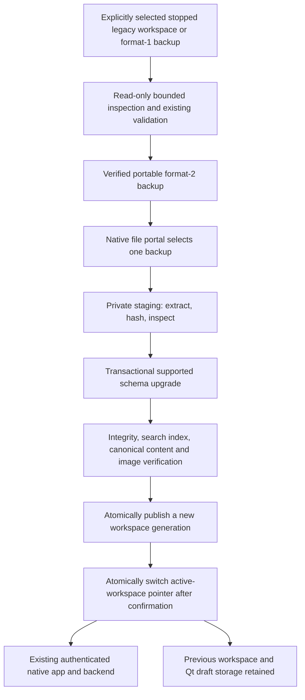

# CyrNava P3 — Migration, backup integrity and recovery

Date: 30 October 2026 (Asia/Seoul). Branch: `desktop/p2-production-integration`.

## A. Executive summary

**P3 STATUS: PASS — automated and owner-executed native verification completed.
Ready for owner phase acceptance. P4 is not authorized or started.**

Final recorded run: `run-a2e0fcaea12a`; all five phases PASS, complete true.
The corrected helper SHA-256 matches current source:
`2695e2495ea5f056475bce86483b5ea76cd1bcc074b1c79cb672cec4852dc56b`.
Evidence copies: `evidence/p3/final-native-2026-10-30/`. Owner confirmation and
both 16:07/16:08 recordings were reviewed. The recordings show the saved title
and pasted screenshot; the restart evidence independently verifies persistence.
Earlier failures and conditional follow-ups below are historical and superseded
by this final record.

P2 is formally accepted from independently inspected final host evidence, not only
the owner's confirmation. Run `run-64a7b56d5fc0` used corrected driver
`p2-portal-window-filter-3`, matching source SHA-256
`d4e5025c567074f7dc653b265e3429c2979e6bc5c70f0c9c6775fab251d8089b`.
Both final records report complete PASS, child exit 0, real Save portal and JSON
readback, offline recovery-draft export, explicit recovery close and backend
reaping. Repository copies are in `evidence/p2-final-2026-10-30/`; original evidence
is under `~/.var/app/org.cyrnava.CyrNava.Devel/data/p2-portal-verification/run-64a7b56d5fc0/`.
Historical failure sections remain in P2_REPORT.md and P2_NATIVE_CHECKS.md, explicitly
superseded by the final acceptance record at the top of each document.

Initial repository inspection found a clean working tree at commit
`808e906dbe977edd4a20ec23f134ad565c54a675` on the requested branch. The accepted
P2 checkpoint manifest records HEAD and tracked-file hashes. No commits, branch
changes, merges or pushes were performed. Change groups are: (1) P2 acceptance
records, (2) P3 migration/domain logic and tests, (3) native maintenance and profile
selection, (4) host verification, benchmarks and this report.

Application version remains 0.1.0. Current schema remains 5. No new dependencies.
No owner's database, Firefox profile or personal notes were opened or migrated.

## B. Architecture

Extends `app.backup` validation and existing database migrations. Existing directory
backup format 1 remains usable. Portable format 2 is a ZIP_STORED archive containing
`engage.sqlite3`, `assets/<validated-id>`, and `manifest.json`. Metadata records
format, application and schema versions, exact member set, byte sizes and SHA-256.
No executable/imported SQL scripts or paths from metadata are executed.

Import creates an independent staging directory and verifies the backup before any
schema change. Supported source schemas 3/4 upgrade to 5 using the existing
transactional `Database.initialize`; schema 5 is validated. Canonical records are
fingerprinted before/after migration, including templates and image BLOBs. The
search index receives a writable integrity check only on the copy. Images are
validated by the existing image decoder and document/ownership validators.

Activation uses Linux `renameat2(RENAME_NOREPLACE)` on one filesystem. The desktop
retains its instance lock; a durable JSON pointer selects the verified generation.
Previous database/assets and corresponding Qt storage remain available. A recovery
selection is explicitly confirmed and revalidated. No automatic replacement or
silent merge into a nonempty destination is offered.

## C. Approved application identity

Owner approved **`io.github._74Cerillion.CyrNava`** on 30 October 2026 in this chat.
It derives from configured Git origin `https://github.com/74Cerillion/CyrNava.git`.
The underscore makes the digit-leading owner component conform to D-Bus naming.
This uses [Flatpak application-ID conventions](https://docs.flatpak.org/en/latest/conventions.html#application-ids)
and [valid identifier component rules](https://gnome.pages.gitlab.gnome.org/gtk/gio/type_func.Application.id_is_valid.html),
not Flathub publication requirements. Independently hosted repositories and GitHub
release infrastructure do not require a different identity.

Identity constants are recorded in `identity.py`. The development runtime remains
hard-bound to `org.cyrnava.CyrNava.Devel`; environment overrides cannot select the
production identity or its storage. Production packaging is intentionally deferred
to authorized P4 work. There is no production package or signing configuration.

| Purpose | Location |
|---|---|
| Legacy browser workspace | `$XDG_DATA_HOME/engage/`, normally `~/.local/share/engage/` |
| Development application | `~/.var/app/org.cyrnava.CyrNava.Devel/` |
| Approved future production app | `~/.var/app/io.github._74Cerillion.CyrNava/` |
| Desktop root inside either identity | `data/cyrnava/` |
| Original desktop workspace | `data/cyrnava/workspace/` |
| Migrated generations | `data/cyrnava/workspaces/<32-hex-id>/` |
| Active pointer | `data/cyrnava/active-workspace.json` |
| Per-generation Qt storage/cache | `web-profile-<id>/`, `web-cache-<id>/` under desktop root |
| Default original Qt storage/cache | `web-profile/`, `web-cache/` |
| Native host-test profiles only | development `data/p3-verification/run-<id>/` |

Changing the production ID after distribution changes Flatpak identity, private
storage, portal permissions, metadata/desktop names and update tracking; it would
need an explicit separately authorized migration, not a string replacement.

## D. Read-only storage inventory

Inventory was derived from code and synthetic fixtures, not from personal data.

- SQLite file: `engage.sqlite3`; assets in sibling `assets/`. IDs, folder parent
  relations, rich document JSON, revisions/timestamps and asset ownership live in
  SQLite. Image blocks reference `/api/assets/<id>`; filenames are validated IDs.
- Schema history: 1 original notes; 2 hierarchy; 3 images; 4 reusable templates and
  template-image snapshots; 5 full-text search. Existing initialization supports
  older upgrades, but P3 import deliberately accepts only validated 3/4/5 inputs.
  Schemas 1/2 must be upgraded by a compatible legacy version first. Future schemas
  are rejected before transformation. No reverse migrations were added.
- Application preferences: browser localStorage `engage.appearance.v1`, CyrNava
  theme preference, `engage.navigation-collapsed.v1`, `engage.note-id.v1`.
  They are not in SQLite and do not transfer automatically between Firefox and Qt.
- Recovery records: `engage.recovery.v1:<note-id>:<writer>` in origin-specific
  localStorage. Pending upload bytes are not guaranteed to be in a recovery JSON.
- Existing directory backups use format 1 and database/assets hash manifests.
  They exclude browser storage. Existing validators check SQLite integrity/FKs,
  hierarchy, native documents, images and templates. P3 reuses them.

**Preference procedure:** choose the desired Appearance and navigation setting in
the new app. Reopen the desired note. No Firefox filesystem access is required.

**Draft procedure:** first recover/save drafts in the old app where possible and
wait for Saved/uploads to finish before closing and backing up. If the backend is
unavailable, explicitly use Download pending draft. In the new native maintenance
manager choose Import an exported recovery draft. Matching note ID/base revision,
format and image references are required; the recovered document is applied to a
new verified workspace copy. Original generation and backup remain intact.
Conflicting revisions, absent notes or missing pending image bytes are rejected;
review those in the old application rather than silently losing or merging them.
Preferences/drafts are explicitly excluded from database backup manifests. Exported
recovery JSON should be retained separately. Existing Qt generations preserve their
own browser preferences and drafts when switching away and back.

## E. Implementation and UX

New files:

- `backend/app/migration.py`: bounded inspection, portable pack/unpack, staging,
  verified migration, recovery-draft import, durable records and content comparison.
- `backend/app/migration_cli.py`: explicit inspect/backup/restore operations;
  no implicit legacy discovery or default personal profile.
- `backend/app/migration_benchmark.py`: synthetic-only fixtures and measurements.
- `backend/tests/test_migration.py`: preservation, security and failure regressions.
- `desktop/native/identity.py`: approved production/development identity constants.
- `desktop/native/maintenance.py`, `maintenance_io.py`: native portal workflow,
  worker progress, confirmation, safe selected-file export, recovery selection.
- `packaging/flatpak/qt_migration_check.py`: real QtWidgets workflow test with
  simulated chooser selections (not native portal evidence).
- `packaging/flatpak/verify_migration.py`, `run_migration_verification.py`,
  `test_run_migration_verification.py`: disposable native phases and host supervisor.
- This report, native checklist and P2/P3 evidence files.

Modified: development snapshot preparation excludes native diagnostic evidence
from the installable candidate (no permission/runtime/installer change);
backup validator (optional bounded read-only mode); desktop storage
(explicit active-generation pointer and recovery-mode validation); native entry
point (`--manage-data`); application (first-launch import offer and Backup and
recovery menu). Normal main-window close drains the accepted P2 protocol before
maintenance. Choosing Keep open cancels the maintenance request. Signal handlers
are restored before deleting the WebEngine window and entering maintenance.

The native manager supports verified backup export, legacy directory preparation,
portable import, exported recovery-draft import and selection of a previous
verified workspace. Native dialogs select only the requested file/directory;
there is no JS/native privilege bridge. Validation/migration work runs off the GUI
thread with visible phase progress. Escape/window-close cannot discard an active
worker. Import displays counts/schema and asks confirmation before activation.
A failed operation displays a redacted explanation and preserves recovery material.

The CLI remains available for administrators/tests, but ordinary native users do
not need to manipulate database files or application directories. A corrupt active
pointer blocks normal launch; explicit maintenance can select a verified preserved
workspace without silently rewriting the damaged pointer.

## F. Security and recovery behavior

- All imported data is untrusted. Members are allowlisted; traversal, absolute
  names, duplicates, symlinks, hard-linked files, special files, encryption and
  compressed entries are rejected. No `extractall` or shell execution.
- Central-directory size/count are bounded before ZIP parsing; ZIP64 is unsupported.
  Limits: 20,000 entries/records, 512 MiB database, 2 GiB uncompressed workspace,
  10 MiB image, 8 MiB manifest and 2 MiB recovery JSON. Imported SQL schema objects
  must match known application definitions; arbitrary triggers/views are refused.
  Existing document/image limits and bounded SQLite validation remain effective.
- Stored ZIP entries avoid decompression bombs; exact lengths, checksums, archive
  member sets, decoded images and database relationships are verified before use.
- Source locking uses the existing cooperative lock read-only; it does not create
  or rewrite a lock in the source. Sidecars are rejected BEFORE any database open.
  Immutable read-only inspection avoids SQLite shared-memory creation. A dirty/WAL
  workspace must first be cleanly shut down in the old application. No live WAL is
  discarded or checkpointed by the migration tool.
- A cooperating CyrNava backend cannot write during backup. Arbitrary same-user
  tools that ignore locks remain outside that coordination contract. Checksums
  detect changed copies; source writers must be stopped. The OS user controlling
  files can still race path components; this is not isolation from a malicious
  process running as the same user.
- Missing references/invalid images reject import. Untracked filesystem assets
  reject import for explicit reconciliation; registered images not currently used
  in a document remain preserved. Identical image contents retain separate IDs,
  with duplicate-content count reported; there is no destructive deduplication.
- No new listener, API endpoint, native bridge, shell permission, host networking
  or filesystem override. P2 authentication, Host/Origin checks, private loopback,
  renderer sandboxing and backend ownership stay in force.
- Source/active data are never removed. Failures retain `.migration-<id>` and a
  redacted `migration-<id>.json`. The prior verified backup and active generation
  remain usable. Retry is explicit and creates a new generation. Interrupted
  staging is not automatically resumed or silently considered successful.
- Atomic visibility assumes Linux renameat2 support and a single filesystem;
  lack of support fails closed. Files/directories and pointer updates are fsynced.
  Power-loss durability still depends on the filesystem/device. If an error occurs
  after publication, the journal records activation uncertainty rather than
  deleting the published profile. A pointer always selects a fully verified copy.
- Quarantined stages and retained backups consume disk until explicitly reviewed.
  Preflight uses available bytes plus headroom, but concurrent disk consumption,
  per-user quota and device failure can still cause mid-operation errors. Those
  paths preserve existing data. Portal exports may leave a partial newly selected
  output file on I/O failure; it is never reported as a verified backup.
- Backups are unencrypted; store them privately. Hashes detect corruption, not an
  attacker who can replace both data and manifest. There is no claim of signed
  backup authenticity or encryption.

Rollback restores/selects a verified compatible snapshot. Downgrading a Flatpak
binary does not downgrade its schema. An older app must use a snapshot within its
supported schema range; P3 rejects future versions. Current recovery selection
requires schema 5. Earlier-format backups can be imported into a new generation
and upgraded forward. No speculative reverse SQL migrations exist.

## G. Verification

Automated results and exact commands are recorded in `evidence/p3/validation.json`.
Only executed tests count as PASS. The full backend suite includes the retained P2
security, lifecycle, storage and API tests. Migration tests use disposable fixtures
and verify source fingerprints, folder/note JSON, images, schema upgrades,
interruption, invalid metadata/archive/hash/schema, links/traversal, disk shortage,
concurrent destination creation, post-upgrade corruption, rollback and explicit
draft recovery. Actual QtWidgets tests cover confirmation, async work, Escape
protection, generation activation, export/readback, rollback and application
event loops before/after maintenance with simulated chooser selections.

Browser launch was initially blocked by session socket policy. After local test
network permission, the suite ran; one appearance-placeholder assertion failed,
then passed three isolated reruns. This historical failure is retained in the
validation record, not silently relabeled. Final rerun status is recorded there.

Actual Flatpak invocation from Codex is BLOCKED (`Unable to allocate instance id`).
No namespace policy or renderer sandbox was disabled to bypass it. Owner-host
execution subsequently passed the real backup portal, native import, saved-edit
persistence, restart, backend reaping, backup restoration, corrupt-input rejection
and verified rollback checks. The native manager workflow was exercised on a
synthetic profile. This P3 evidence is independent of the prior P2 native PASS.

## H. Performance baseline

See `evidence/p3/performance.json`. Synthetic 128×128 deterministic-noise PNGs,
rich text and nested folders; each size measured in a fresh process. These are
local development baselines, not release performance guarantees or arbitrary
pass thresholds. Final defensive/UI additions were made after baseline collection.

| Notes / images | Source bytes | Backup s | Verify s | Restore s | Peak RSS KiB | Sampled extra disk bytes |
|---|---:|---:|---:|---:|---:|---:|
| 10 / 10 | 616410 | 0.077 | 0.023 | 0.050 | 39260 | 1857396 |
| 250 / 250 | 13083722 | 1.705 | 0.530 | 1.101 | 41724 | 39466496 |
| 1500 / 1500 | 77908412 | 11.128 | 3.555 | 8.323 | 46500 | 235009319 |

Backup time includes copy and self-verification. Restore includes validation,
schema initialization, preserved rollback archive and durable publication. Memory
is process high-water RSS including fixture generation. Disk is logical file size
sampled every 10 ms and can miss brief peaks; allocated blocks/metadata differ.
The GUI additionally retains a preview/import copy, so reserve more space than the
core benchmark. Stored archives favor predictable bounded handling over compression.

## I. Data preservation evidence

Synthetic tests compare every original file's SHA-256 before/after successful and
failed operations. Roundtrips compare complete note records, hierarchy and image
bytes, then reopen and save again. A canonical fingerprint rejects even a valid
SQLite copy whose note title changed unexpectedly during migration. Tests retain
an earlier usable generation while importing, restore it through the pointer,
reject incompatible schema selection and verify that the pointer is unchanged.
Disk-full and interrupted cases never replace an existing destination.

These are synthetic guarantees with stated filesystem assumptions. No real-owner
migration was performed or inferred from these tests.

## J. Decisions and limitations

- Production ID approval: obtained. Runtime/manifest switch awaits P4 authorization.
- Host verification: completed and independently inspected from recorded results.
- Browser preferences: explicit reconfiguration; no Firefox profile extraction.
- Conflicting drafts, absent notes and pending image bytes: explicit legacy review;
  not silently merged or claimed recoverable.
- Limits above intentionally reject larger workspaces. Increasing them needs
  measured resource review; no partial import is offered.
- Native host results may require focused corrections; preserve evidence first.
- No real-data migration, publication, signing, merge, commit or push is authorized.

## K. Recommendation and owner acceptance checklist

**PASS. Automated and native acceptance checks completed. Ready for owner phase
acceptance; P4 and real-data migration require separate authorization.**

- [x] P2 final recorded evidence independently verified and acceptance documented.
- [x] Production identity proposed and approved by owner.
- [x] Synthetic migration/backup/recovery implementation and automated checks.
- [x] Real native backup export/import portal and JSON/DB/image validation.
- [x] Native autosave, screenshot persistence, close and restart after migration.
- [x] Host failure/recovery exercise and final supervisor PASS.
- [ ] Owner review of P3 report and evidence; explicit approval before P4.

Follow `P3_NATIVE_CHECKS.md`. Stop after P3.

## Owner verification follow-up — 30 October 2026

The build succeeded. Runs `run-f467a263b4d0` and `run-debbbe523b30`
failed in PREPARE with no passed checks. The recording shows the native Save
file chooser, an empty Name field and disabled Save; migration prompts belong to
the later IMPORT phase. The generic previous error does not prove whether the
chooser was cancelled or another exception occurred. Evidence is preserved under
`evidence/p3/owner-2026-10-30-save-dialog/`.

The streamed verification helper now suggests a unique `.cyrnava` filename,
explains the Save step, checkpoints its stage and records explicit cancellation.
No application behavior or permissions changed. Six supervisor/snapshot tests,
Ruff and diff checks passed. Native verification remains pending; no rebuild is
needed for these host-streamed helper changes.

### Follow-up: run-7b69a3f8e674

PREPARE passed real native backup export and readback. IMPORT failed. The
recording shows Create verified backup selected before importing into the empty
destination, then an explicit Operation failed message at 0%. The destination
has no database; no import was completed. This is not evidence of an export
worker hang. The host instructions now identify the second button, Import backup
into a new workspace. Raw results and review are preserved alongside earlier
owner evidence. No production code or permissions changed. P3 remains conditional.

### Portal initialization correction: run-d6ad0ae96bd0

The recording shows a sandbox-local initial Save chooser and a later host-native
Import chooser. PREPARE recorded file write/readback PASS, but that did not prove
a document portal grant. IMPORT did not complete. Prior raw records are retained
unchanged; earlier claims of real host-portal delivery are superseded by this
limitation. No P3 host-portal acceptance is granted.

Qt 6.11's platform theme queries the portal version asynchronously and constructs
a base-theme fallback while the version is unset. The driver opened the first
chooser immediately after QApplication construction. This is the identified
startup race consistent with the observed different choosers. Reference:
[Qt platform-theme source](https://raw.githubusercontent.com/qt/qtbase/6.11/src/plugins/platformthemes/xdgdesktopportal/qxdgdesktopportaltheme.cpp),
constructor and createPlatformDialogHelper.

The streamed driver now performs a bounded FileChooser version query on the
same session bus and delivers pending theme callbacks before constructing Save.
Unavailable portals fail closed. PREPARE also requires the selected destination
to be within the user's document-portal mount; ephemeral sandbox HOME outputs
cannot pass as host exports. No production code, manifest or permission changed.

The actual Qt event-delivery regression passes with simulated DBus replies:
pending theme callback delivery, unavailable/version-zero portal rejection, and
ephemeral/traversal destination rejection. The existing Qt migration workflow
probe and all six supervisor/snapshot tests pass. Real corrected host Save/import
remains NOT TESTED pending owner execution. No rebuild is required.

### Owner edit prerequisite: run-a2e0fcaea12a

PREPARE now passes the required document-portal destination and archive readback.
IMPORT passes schema upgrade, source preservation and exact data preservation.
Read-only inspection after the final failure finds the two original synthetic
titles and two original assets: neither the required `P3 owner edit` title nor a
third pasted image was saved. No database integrity failure was observed.
Historical EDIT/RESTART PASS records only attest to normal window closure; they
do not establish saved-edit persistence. VERIFY correctly failed, but its error
was insufficiently specific. Raw records remain preserved.

The driver now checks saved title/image prerequisites immediately after EDIT and
RESTART and records individual PASS/FAIL checks with a redacted reason. The host
supervisor supports `--resume run-a2e0fcaea12a`, validates prior successful portal
and import records, archives previous results and reruns only EDIT onward. No
production application changes. Twelve supervisor/snapshot/resume tests and the
Qt probe's unedited/edited fixture checks pass. Owner native continuation pending.
