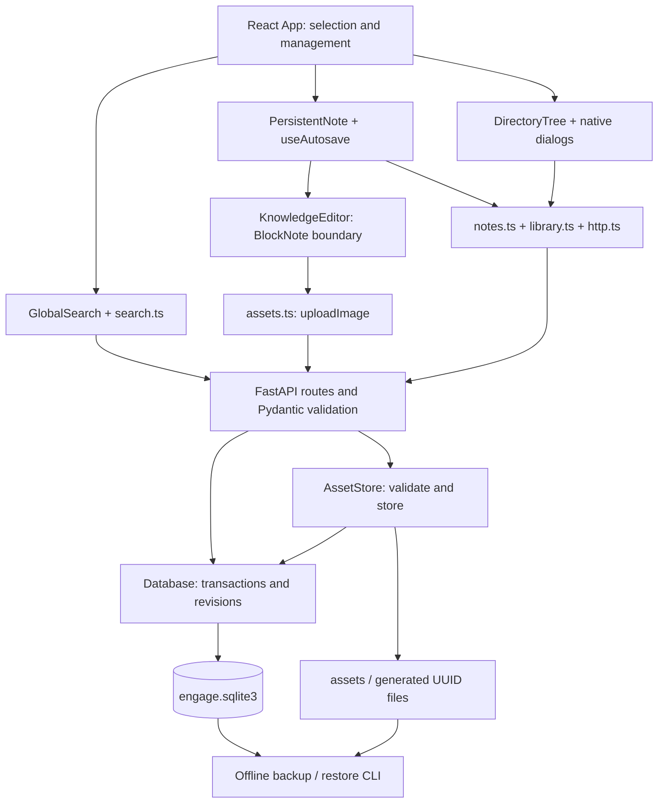

# Architecture of CyrNava v0.1.0

CyrNava is a local cybersecurity knowledge workspace. It does not yet implement engagement/host/vulnerability entities, integrations, tags or cloud services. Search is implemented through backend/frontend M3, with M4 validation and [synthetic benchmarks](search-benchmark.md). Owner commit/publication remains pending. The code is a React/TypeScript UI plus a local Python/FastAPI application, with SQLite and raster image files outside the checkout.

## Execution environments

Development uses Vite on `127.0.0.1:5173` and FastAPI on `127.0.0.1:8000`. Vite proxies `/api/*` and maps `/api/health` to `/health`.

Local release mode uses `backend/app/__main__.py` (`python -m app`). It fixes Uvicorn's host to `127.0.0.1`, builds the existing FastAPI app with a `frontend_path`, and `app/release.py` serves `frontend/dist/index.html`, hashed `/assets/*`, local third-party notices and the `/api/health` alias. Unknown paths/API routes remain 404. No Vite process, reverse proxy, cloud service or packaging daemon is needed. Its CSP permits same-origin scripts/requests/fonts and the inline styles required by the editor; there are no remote runtime assets.

Desktop launches extend the existing `desktop/launcher.py` with an owning supervisor and opt-in `app/lifecycle.py` leases. Each page registers an unpredictable ID; heartbeats renew it, pagehide offers a close hint, and expiration provides the fallback. The supervisor alone holds termination authority. Direct development/release entrypoints do not opt in and have no automatic shutdown. See [desktop operation and recovery](desktop-launcher.md) and the [lifecycle report](../LIFECYCLE_REPORT.md).

## Frontend boundaries

- `appearance.tsx` wraps `Workspace` in one application-level `MantineProvider`, defaulting to `auto` (System) and using Mantine's localStorage manager with `engage.appearance.v1`. `AppearanceControl` changes this existing provider state. `App` resolves it with `useComputedColorScheme`, then passes the resulting `light`/`dark` presentation prop through `PersistentNote` to `KnowledgeEditor` and the supported `BlockNoteView.theme` API. BlockNote reuses the enclosing Mantine provider, including portals. There is no parallel preference state, keyed theme remount, backend call or document mutation.
- `styles.css` defines application color tokens on `:root` and overrides them for `data-mantine-color-scheme="dark"`, the attribute Mantine owns. Native controls inherit CSS `color-scheme`; dialogs, tree states, text, buttons and save/error indicators use those tokens. BlockNote supplies its native theme for document/menu surfaces; a small muted-text/placeholder contrast correction uses its CSS variables and empty-paragraph hint selector. `withCssVariables={false}` retains the editor bundle's scoped Mantine variables and avoids adding global resets or changing the light UI's typography.
- `public/assets/appearance-init.js` is a tiny blocking same-origin head script in `index.html`. It reads only the appearance preference, resolves System through `matchMedia`, and sets the same root attribute before React loads. It does not write localStorage or subscribe to events; Mantine takes over after mount. Its existing `/assets` path works under release CSP without adding inline script permission or changing the backend. A test executes this actual script to check key/default consistency with the provider.
- `src/App.tsx` owns the open note, library summaries, selected tree item, expanded folders and current management dialog. `perform` drains pending uploads/saves before transitions. A failed drain keeps the current draft open. Confirmed recovery remounts the same note with the new persisted revision.
- Navigation collapse is separate React state in `App`, persisted under `engage.navigation-collapsed.v1` in localStorage. The sidebar remains mounted with `hidden`; a workspace data attribute changes the grid to one column. The editor key, selection and autosave do not depend on this preference. The toolbar remains outside the hidden sidebar.
- `components/DirectoryTree.tsx` renders an iterative adjacency-list view from `tree.ts`, with keyboard handlers scoped to the tree, roving focus, selected/open markers and explicit hierarchy ARIA. `ManagementDialog` handles creation, rename, move and deletion confirmation. It is not a second persistence layer.
- `components/KnowledgeEditor.tsx` imports BlockNote core/react/mantine. It configures the supported schema, upload/paste hook, upload-only image panel and error feedback. Other modules use application-owned `NoteDocument` JSON and the small `flushUploads` interface. Replacing the editor would still require a document-format migration: the boundary isolates APIs, not the stored content format.
- `PersistentNote` joins the adapter with `hooks/useAutosave.ts`. Autosave debounces 700 ms, serializes PATCH requests and distinguishes local edit numbers from the database revision. A response acknowledges only its submitted snapshot; it never installs an older document over current typing. API failures remain visible until Retry; local validation resumes on correction.
- `ConflictRecovery` is read-only: inspect the saved document, download both versions, verify retention, then explicitly fetch/reopen the latest saved note. No stale force-save or automatic merge is offered.
- `notes.ts`, `library.ts`, `assets.ts` and `http.ts` own HTTP contracts/timeouts/errors, not BlockNote internals. The browser remembers a preferred note ID plus unconfirmed recovery drafts through `drafts.ts`; SQLite remains authoritative. `PersistentNote` offers recovery before mounting the adapter. `useLifecycle` owns page leases independently of note selection.
- `ManagementDialog` adds optional template selection to New note, defaulting to blank. `TemplateManager` handles the small custom rename/delete dialog. `templates.ts` owns those HTTP calls; `notes.createNoteFromTemplate` validates the resulting note with the existing note response checker. The editor imports no template API. `NoteHandle.getRevision` exposes only the latest acknowledged revision so a flushed snapshot can be captured without accepting unseen edits from another tab.

- `components/GlobalSearch.tsx` owns query text, 300 ms debounce, cancellation/generation guards, result status and combobox/listbox keyboard selection. Its only navigation output is a note ID. `search.ts` validates the existing M2 response, uses the shared timed HTTP client and preserves backend ranking. Search state stays in memory. `App.openSearchNote` uses `perform` for different notes, then fetches canonical JSON and a fresh tree before committing selection/ancestor expansion. The already-open note keeps its editor. `refreshTree` also invalidates active search results after committed changes, without updating the editor.

## Backend and persistence

`app/main.py` owns routing and maps domain errors to 404/409/422/503. `models.py` validates request envelopes. `documents.py` bounds native JSON and validates known properties against `document_format_v1.json`, a snapshot checked against the editor adapter schema. Unknown blocks/content shapes remain outside the version-1 boundary; bounded extension metadata is preserved. See [document compatibility](document-format.md). `database.py` owns connections, parameterized SQL and transactions. Every connection enables foreign keys. `BEGIN IMMEDIATE` serializes relationship validation and writes. Note updates use an atomic expected-revision predicate; stale writes affect no content.

Schema version is 5. Folders form nullable-parent adjacency lists; notes use nullable folder IDs, titles, native `document_json`, format version 1, revision and timestamps. Asset metadata links opaque UUIDs to owning notes and generated disk basenames. The M1-to-M2 migration copied named note fields unchanged; M4 added assets. FF-018 adds `templates` and `template_images` in the established initialization transaction without rebuilding or rewriting notes, folders or assets. F-09 M2 adds the derived `note_search_documents` projection and external-content FTS5 `note_search` index, populated from native JSON. Projection triggers synchronize FTS; successful canonical note create/update and template instantiation update the projection in their existing transactions. Cascading note deletion removes search entries. Search reads a consistent snapshot and resolves current folder breadcrumbs. The offline rebuild command replaces derived objects only. See [search design and operation](search.md). Future schema versions fail rather than resetting a newer database.

`app/templates.py` owns five built-in definitions and `TemplateStore` operations. Custom templates store native JSON, format version, revision, timestamps and name in `templates`. `template_images` stores independent normalized raster snapshots as SQLite BLOBs, keyed by template and original asset UUID, with a cascading foreign key to its template. These are not references to source-note files. The 50 MiB aggregate cap bounds materialized image reads per template; the existing 10 MiB per-image/decode limits remain in force. Built-ins are code-owned and are not duplicated in SQLite.

Capture takes a source note ID and expected confirmed revision. Under `BEGIN IMMEDIATE`, it validates ownership, reads the source document and copies referenced images into SQLite, leaving the source unchanged. Instantiation validates a built-in/custom definition and its expected revision, assigns fresh note/block/asset IDs, rewrites image URLs, writes ordinary note-owned image files and commits the new note plus asset metadata. SQL failure rolls back records and removes newly written files; crash leftovers use the existing orphan reconciliation. Generated notes use the existing editing/autosave path. Custom rename/delete also check revisions. There is no template editor, inheritance or propagation to generated notes.

`assets.py` verifies PNG/JPEG/WebP content with Pillow, enforces encoded/pixel/dimension limits and normalizes raster bytes before storing private generated files. URLs are `/api/assets/{UUID}`. No user filename becomes a path. Note saves validate ownership. Files and SQLite are not one shared transaction: write/fsync precedes metadata commit; failures clean up, and startup/post-delete reconciliation removes unowned generated files. Owned but unreferenced uploads are retained until note deletion to protect pending/failed saves. Original image metadata is removed and JPEG is recompressed; this is not forensic-original storage.

Data is at `$XDG_DATA_HOME/engage/` for absolute XDG values, otherwise `~/.local/share/engage/`. New directories/files use 0700/0600. The checkout is rejected as a runtime data or backup location. Data is local and unencrypted; localhost is not protection from malware running as the same OS user.

## Concrete flows

### A. Save a note

Typing → `BlockNoteView.onChange` → structured native snapshot from `KnowledgeEditor` → `useAutosave.changeDocument` → debounced `notes.updateNote` → `http.request` PATCH with expected revision → `main.update_note` and Pydantic validation → `Database.update` validates image ownership and updates `WHERE id=? AND revision=?` inside a transaction → `search.index_note` extracts text and updates the projection/FTS within that transaction → commit/revision increment → checked response → acknowledge that local version → Saved only when the current version is confirmed. New typing during a request remains unsaved and is sent next. A conflict preserves the draft.

### B. Retrieve an image

`App` calls `getNote` → FastAPI `get_note` → `Database.get` decodes native JSON → adapter mounts its saved blocks → browser requests a relative asset URL → `main.get_asset` → `AssetStore.retrieve` checks metadata, allowlisted MIME, basename, approved root, symlink refusal and byte size → filesystem bytes with nosniff/CSP headers → browser renders the image at its stored position. A missing image triggers an adapter alert while preserving surrounding text/reference.

### C. Create/move a folder

Tree selection chooses the parent → `App.newItem`/`manage` uses `perform` to flush the current editor → `ManagementDialog` collects name/destination → `library.createFolder` or `updateFolder` → FastAPI `create_folder`/`update_folder` validates UUID/name → `Database.create_folder`/`update_folder` checks parent/cycles and writes in a serialized transaction → response → `refreshAfterChange` reads authoritative summaries → tree updates, reveals ancestors and restores focus. Folder deletion adds fresh descendant counts and a subtree fingerprint; the backend rechecks intent and deletes children first atomically. Assets are cleaned only after a committed deletion.

### D. Search and open a result

Typing in `GlobalSearch` → cancel/invalidate old query state → 300 ms timer → `search.searchNotes` → shared `http.request` GET `/api/search` → M2 `Database.search` and FTS5 → validated response → render plain text/highlights if the request is still current. Arrow keys stay on the search field with `aria-activedescendant`; Enter/click emits a note ID. `App.openSearchNote` → `perform` → `PersistentNote.flush` uploads/saves → `getNote` + `refreshTree` → check note is still present → `setNote`/`setSelected`/`reveal`/`remember`. A failed flush or read keeps the original editor mounted. Search success never writes note content.

## Recovery and dependencies

`profile.py` uses cooperative shared locks during backend lifetime and exclusive locks for offline backup/rebuild. Schema upgrades also require exclusivity through commit; current-schema initialization and the serving lifetime use shared locks. The application does not serve requests between initialization and acquiring its lifetime lock. A competing offline operation can cause startup to refuse safely. `backup.py` validates read-only SQLite, ownership, images and manifest hashes, copies unchanged data through private staging, refuses existing destinations and restores to a new profile. It is an offline procedure, not live snapshotting. External/older writers must also be stopped. See [backup instructions](../BACKUP_RESTORE.md).

Backup validation accepts schema 3, 4 and 5. For schema 4 and 5 it additionally validates template JSON, image membership, MIME, size and raster decoding. Template image snapshots are already in the SQLite file, so the manifest format and filesystem asset layout stay unchanged. Restoring a schema-3 backup preserves that copy verbatim; the new backend migrates only the restored runtime copy on startup. Old application versions reject schema 5; downgrade requires the retained pre-upgrade backup.

Runtime frontend dependencies are the three non-XL BlockNote packages, React/React DOM and Mantine. Runtime backend dependencies are FastAPI/Pydantic/Uvicorn/Pillow and their pinned resolution. Vitest/Testing Library and Playwright cover different testing layers; they are not production services. Versions and obligations are in [dependency review](dependencies-and-licenses.md). ADRs record observed decisions, not invented historical discussions.
