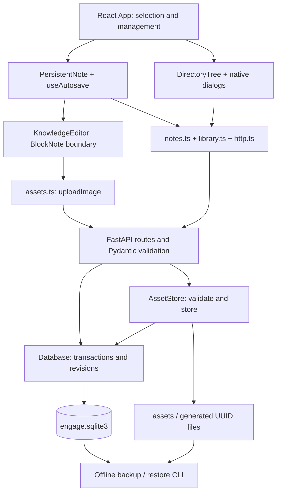

# Architecture of ENGAGE v0.1.0

ENGAGE is a local cybersecurity knowledge workspace. It does not yet implement engagement/host/vulnerability entities, integrations, search, tags or cloud services. The code is a React/TypeScript UI plus a local Python/FastAPI application, with SQLite and raster image files outside the checkout.

## Execution environments

Development uses Vite on `127.0.0.1:5173` and FastAPI on `127.0.0.1:8000`. Vite proxies `/api/*` and maps `/api/health` to `/health`.

Local release mode uses `backend/app/__main__.py` (`python -m app`). It fixes Uvicorn's host to `127.0.0.1`, builds the existing FastAPI app with a `frontend_path`, and `app/release.py` serves `frontend/dist/index.html`, hashed `/assets/*`, local third-party notices and the `/api/health` alias. Unknown paths/API routes remain 404. No Vite process, reverse proxy, cloud service or packaging daemon is needed. Its CSP permits same-origin scripts/requests/fonts and the inline styles required by the editor; there are no remote runtime assets.

## Frontend boundaries

- `src/App.tsx` owns the open note, library summaries, selected tree item, expanded folders and current management dialog. `perform` drains pending uploads/saves before transitions. A failed drain keeps the current draft open. Confirmed recovery remounts the same note with the new persisted revision.
- `components/DirectoryTree.tsx` renders an iterative adjacency-list view from `tree.ts`, with keyboard handlers scoped to the tree, roving focus, selected/open markers and explicit hierarchy ARIA. `ManagementDialog` handles creation, rename, move and deletion confirmation. It is not a second persistence layer.
- `components/KnowledgeEditor.tsx` imports BlockNote core/react/mantine. It configures the supported schema, upload/paste hook, upload-only image panel and error feedback. Other modules use application-owned `NoteDocument` JSON and the small `flushUploads` interface. Replacing the editor would still require a document-format migration: the boundary isolates APIs, not the stored content format.
- `PersistentNote` joins the adapter with `hooks/useAutosave.ts`. Autosave debounces 700 ms, serializes PATCH requests and distinguishes local edit numbers from the database revision. A response acknowledges only its submitted snapshot; it never installs an older document over current typing. API failures remain visible until Retry; local validation resumes on correction.
- `ConflictRecovery` is read-only: inspect the saved document, download both versions, verify retention, then explicitly fetch/reopen the latest saved note. No stale force-save or automatic merge is offered.
- `notes.ts`, `library.ts`, `assets.ts` and `http.ts` own HTTP contracts/timeouts/errors, not BlockNote internals. The browser remembers only a preferred note ID; SQLite remains authoritative.

## Backend and persistence

`app/main.py` owns routing and maps domain errors to 404/409/422/503. `models.py` validates request shapes, bounds native JSON and limits accepted blocks. `database.py` owns connections, parameterized SQL and transactions. Every connection enables foreign keys. `BEGIN IMMEDIATE` serializes relationship validation and writes. Note updates use an atomic expected-revision predicate; stale writes affect no content.

Schema version is 3. Folders form nullable-parent adjacency lists; notes use nullable folder IDs, titles, native `document_json`, format version 1, revision and timestamps. Asset metadata links opaque UUIDs to owning notes and generated disk basenames. The M1-to-M2 migration copied named note fields unchanged; M4 added assets. M6 does not migrate or reformat existing data. Future schema versions fail rather than resetting a newer database.

`assets.py` verifies PNG/JPEG/WebP content with Pillow, enforces encoded/pixel/dimension limits and normalizes raster bytes before storing private generated files. URLs are `/api/assets/{UUID}`. No user filename becomes a path. Note saves validate ownership. Files and SQLite are not one shared transaction: write/fsync precedes metadata commit; failures clean up, and startup/post-delete reconciliation removes unowned generated files. Owned but unreferenced uploads are retained until note deletion to protect pending/failed saves. Original image metadata is removed and JPEG is recompressed; this is not forensic-original storage.

Data is at `$XDG_DATA_HOME/engage/` for absolute XDG values, otherwise `~/.local/share/engage/`. New directories/files use 0700/0600. The checkout is rejected as a runtime data or backup location. Data is local and unencrypted; localhost is not protection from malware running as the same OS user.

## Three concrete flows

### A. Save a note

Typing → `BlockNoteView.onChange` → structured native snapshot from `KnowledgeEditor` → `useAutosave.changeDocument` → debounced `notes.updateNote` → `http.request` PATCH with expected revision → `main.update_note` and Pydantic validation → `Database.update` validates image ownership and updates `WHERE id=? AND revision=?` inside a transaction → commit/revision increment → checked response → acknowledge that local version → Saved only when the current version is confirmed. New typing during a request remains unsaved and is sent next. A conflict preserves the draft.

### B. Retrieve an image

`App` calls `getNote` → FastAPI `get_note` → `Database.get` decodes native JSON → adapter mounts its saved blocks → browser requests a relative asset URL → `main.get_asset` → `AssetStore.retrieve` checks metadata, allowlisted MIME, basename, approved root, symlink refusal and byte size → filesystem bytes with nosniff/CSP headers → browser renders the image at its stored position. A missing image triggers an adapter alert while preserving surrounding text/reference.

### C. Create/move a folder

Tree selection chooses the parent → `App.newItem`/`manage` uses `perform` to flush the current editor → `ManagementDialog` collects name/destination → `library.createFolder` or `updateFolder` → FastAPI `create_folder`/`update_folder` validates UUID/name → `Database.create_folder`/`update_folder` checks parent/cycles and writes in a serialized transaction → response → `refreshAfterChange` reads authoritative summaries → tree updates, reveals ancestors and restores focus. Folder deletion adds fresh descendant counts and a subtree fingerprint; the backend rechecks intent and deletes children first atomically. Assets are cleaned only after a committed deletion.

## Recovery and dependencies

`profile.py` uses cooperative shared locks during backend lifetime and exclusive locks for offline backup. `backup.py` validates read-only SQLite, ownership, images and manifest hashes, copies unchanged data through private staging, refuses existing destinations and restores to a new profile. It is an offline procedure, not live snapshotting. External/older writers must also be stopped. See [backup instructions](../BACKUP_RESTORE.md).

Runtime frontend dependencies are the three non-XL BlockNote packages, React/React DOM and Mantine. Runtime backend dependencies are FastAPI/Pydantic/Uvicorn/Pillow and their pinned resolution. Vitest/Testing Library and Playwright cover different testing layers; they are not production services. Versions and obligations are in [dependency review](dependencies-and-licenses.md). ADRs record observed decisions, not invented historical discussions.
