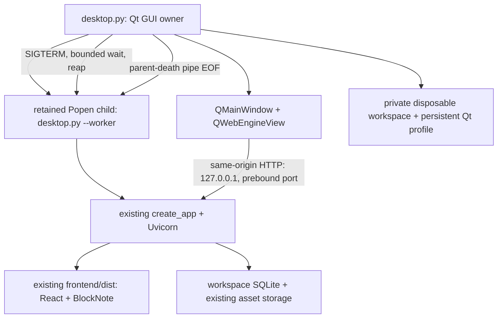

# CyrNava P1 desktop feasibility assessment

Date: 29 October 2026. Branch: `prototype/p1-pyside6-feasibility`. Baseline: `cbf7ccc`.

## 1. Result and recommendation

The existing React/BlockNote production build works in a native PySide6 + Qt WebEngine window on this Wayland session. Ten automated native-window journeys passed, including rich-text editing, native screenshot paste, image upload, navigation, SQLite persistence, persistent Qt preferences, failed-save closure and explicit draft recovery across three desktop/backend launches. Twenty-two Python safety/lifecycle tests passed.

**Do not adopt this implementation for production yet.** The mandatory complete renderer-sandbox gate did not pass: Chromium reports no Layer 1, PID or network namespace sandbox. Seccomp is active, and no sandbox-disabling override was used. Private-network Flatpak operation could not be demonstrated here. These are unresolved feasibility/security gates, not passing tests. Retain PySide6 as a viable candidate; approve a bounded follow-up verification on a suitable host before choosing it for production. The current installed Firefox launcher remains the supported path.

P1 implementation and evidence are ready for architectural review, with the security acceptance gate explicitly blocked. No P2–P6 implementation, production installer changes, real-data migration, package publication, commit or push occurred.

## 2. Architecture and actual execution flow



`desktop.py::run` validates the environment and calls `workspace_path`, which accepts only marked, owned disposable directories under `/tmp/cyrnava-p1`. Root and workspace permissions are restricted to 0700; process umask is 0077. XDG data/config/cache paths are redirected there. The actual database path is passed explicitly to the existing app factory; no production profile discovery occurs.

`bind_backend` acquires a real `127.0.0.1` socket before launching the child and persists the port in the workspace marker. A nonblocking workspace `flock` rejects duplicate owners. The GUI passes the listening socket and parent-death pipe to its retained `Popen` worker. `backend` imports the unchanged `app.main.create_app`, supplying the disposable database path and existing `frontend/dist`, then runs Uvicorn. There is no Vite server or Node runtime in the running desktop application.

The GUI polls a prototype-only readiness route containing a random per-launch nonce, using a proxy-free HTTP opener. Only after the expected response does it load the frontend. Startup has a 20-second deadline and a visible failure message. A startup/dead backend does not prevent explicit closure. A second workspace may run its own isolated backend; this experiment does not introduce a global production singleton.

Typing follows the unchanged `KnowledgeEditor` → React autosave/recovery logic → same-origin API → existing routes/persistence → disposable SQLite path. BlockNote native JSON stays canonical. Existing image endpoints write inside that workspace's asset directory. No native JavaScript bridge executes note content or provides filesystem commands.

Normal window close checks the existing save-state UI and uploads. Saved content allows immediate close; an unconfirmed save or stopped/unresponsive backend opens an explicit native choice, defaulting to **Keep open**. **Close prototype** retains the workspace and previously stored recovery records. This is a prototype guard based on UI state, not a production flush contract. Full flush/upload handshake integration remains deferred.

After Qt exits, `stop_child` sends SIGTERM only to the retained backend child, waits up to 12 seconds, escalates only that child if required, and reaps it. Uvicorn allows eight seconds for accepted requests. The parent-death pipe also stops the worker if the GUI disappears without cleanup. SIGTERM/Ctrl+C exits the Qt event loop without opening an interactive save modal, then performs cleanup. Pages are destroyed before their persistent profile to flush Qt storage. A killed renderer/GUI cannot guarantee every latest storage write reached disk.

Reopening the same workspace preserves its origin/port, SQLite and Qt profile. React reloads the saved note from SQLite; its existing localStorage recovery UI offers unconfirmed drafts explicitly. The test recovered a title edited during a backend outage and then verified the new title in SQLite and after reload. Clearing `/tmp`, changing profile/origin, storage failure or unfinished image uploads remains outside that guarantee.

## 3. Changed files and dependencies

All additions are confined to `prototypes/p1_desktop/`; no tracked production files were modified.

| New file | Responsibility and dependencies |
| --- | --- |
| `desktop.py` | Disposable native shell, profile restrictions, backend ownership/readiness/termination, navigation restrictions, close choice and diagnostics. Stdlib + pinned PySide6; worker reuses the existing backend. |
| `requirements.txt` | Includes the existing pinned backend requirements and pins four Qt distributions for this experiment only. |
| `test_desktop.py` | Existing pytest framework; temporary profile/path/port/override checks and a real backend subprocess with parent-death cleanup. |
| `verify.mjs` | Existing Playwright package plus Node builtins; real Qt-window journeys through test-only CDP, native clipboard stimulus, explicit native close-button choices and process measurements. |
| `inspect_environment.py` | Stdlib installed/download size measurement, restricted bubblewrap network probe and optional blank isolated Firefox launch. |
| `README.md` | Setup/run/reopen/close/check instructions and limitations. |
| `REPORT.md` | This decision and evidence record. |
| `evidence/verification.json` | Raw final ten-journey results, three launch measurements, process samples and sandbox outcome. Synthetic identifiers only. |
| `evidence/environment.json` | Raw dependency sizes and failed environment/Firefox probes. |
| `evidence/sandbox.txt` | Actual Chromium sandbox diagnostic text. |
| `evidence/desktop.png` | Visually inspected native-window capture containing only synthetic note content. |

Prototype dependency pins:

| Distribution | Version | Reason |
| --- | --- | --- |
| PySide6 | 6.11.3 | Python Qt bindings; minimal native window and WebEngine. |
| PySide6_Addons | 6.11.3 | Contains the required Qt WebEngine components. |
| PySide6_Essentials | 6.11.3 | Core/GUI/widgets required by the shell. |
| shiboken6 | 6.11.3 | Matching binding runtime. |

The environment is `/tmp/cyrnava-p1/venv`, separate from the production backend venv. All four Qt versions are pinned to prevent mixed binding/runtime patches. This deliberately uses the documented 6.11 Flatpak runtime/BaseApp line rather than choosing the latest release independently. A future Flatpak must align Qt/PySide/BaseApp versions and add hashes/offline sources; these pip pins alone are not a reproducible Flatpak lock. Existing production Python requirements and npm lockfile were preserved. No additional test framework was introduced. [PySide BaseApp documentation](https://github.com/flathub/io.qt.PySide.BaseApp).

## 4. Tests executed and observed failures

All application data used below is synthetic and isolated. No test targets the personal profile. The original user-supplied test results from earlier milestones are not counted as P1 test passes.

| Check | Result |
| --- | --- |
| `python -m pytest -q -p no:cacheprovider prototypes/p1_desktop/test_desktop.py` | **22 passed**. Private workspace/reopen, personal-path refusal, storage symlinks, inherited sandbox/debug overrides, stable/occupied/invalid ports, real release serving/CSP/temporary note creation and worker exit on parent pipe EOF. |
| `python -m ruff check prototypes/p1_desktop` | Passed. |
| `python -m ruff format --check prototypes/p1_desktop` | Passed. |
| `python -m pip check` in isolated environment | Passed. |
| Existing frontend `npm run build` | Passed, 831 modules; existing large-chunk advisory remains. Ignored build output only. |
| `node prototypes/p1_desktop/verify.mjs` | **10 functional journeys passed** on actual Wayland Qt windows. Overall exit **2** because the complete sandbox gate failed. |
| Actual `chrome://sandbox` plus renderer `/proc` inspection | Partial isolation confirmed; **complete sandbox acceptance failed**. Details below. |
| Private network bubblewrap probe | Blocked before bind/connect by namespace permissions. Not a Flatpak pass. |
| Dedicated blank system Firefox launch | Failed with Snap/DBus error, exit 46. No comparable Firefox performance measurement obtained. |

Final native-window journeys:

1. A duplicate workspace launch is refused before it starts a second backend.
2. A different-origin fetch is blocked before reaching an owned loopback canary server.
3. BlockNote heading, paragraph, bold and code editing works.
4. An actual QImage on the Qt clipboard pasted with Ctrl+V uploads and renders.
5. Image-selector upload stores canonical native JSON and a second decodable image.
6. Tree/search navigation works and normal desktop closure releases its backend listener.
7. A full Qt/backend restart restores exact document JSON, images, selected note, appearance and navigation preferences.
8. After a failed save, the native close dialog defaults to Keep open, preserves the open window when selected, and allows explicit closure without deleting its profile.
9. Reopening offers the offline edit as an explicit recovery draft, saves it through the existing API, and preserves it after reload.
10. Native navigation policy rejects a different-origin main-frame link; the controlled canary receives no request.

Important bounds: the upload chooser is intercepted by Playwright, so a real OS/portal file dialog is **not** verified. QImage paste is real native Qt clipboard input; taking screenshots in an external screenshot utility is not tested. The capture uses the prototype's own QWidget, not a full desktop screenshot. Other image types, large notes, all editor commands, X11, GPU/driver combinations, power loss, aarch64 and an actual Flatpak install were not exhaustively tested. The full production regression suites were not rerun because production code is unchanged; the built frontend and existing application flow were exercised by the P1 journeys.

Failures encountered and corrected:

- Qt does not implement the Playwright default `Browser.setDownloadBehavior` CDP call. The harness connects with `noDefaults: true`; it does not weaken Chromium's sandbox or the app's security policy.
- Initial automation assumed a navigation button remained visible after preferences were restored. Readiness now uses the always-visible Appearance control, with exact accessible-role matching.
- OS termination originally called `app.quit`, which could enter the unsaved-close guard and block cleanup. It now exits the event loop directly and cleans up its owned child in `finally`.
- The owner then reported the remaining interactive-close dead end shown in the screenshot: a dead backend could never reach Saved. That guard now offers an explicit close choice; journey 8 is the actual Qt regression check. Already-running old windows need a one-time force quit because they cannot load changed Python code.
- Qt profile cleanup initially warned about live pages; explicit page-before-profile destruction removed that warning. The native banner layout was also corrected to stop consuming half the window.
- A deliberately rejected navigation can leave Playwright waiting on a navigation that Qt will not accept. The negative navigation test runs last; production navigation policy remains restrictive. This is a harness compatibility limitation, not justification for allowing external navigation.

## 5. Performance and package-size implications

Raw values are retained in `evidence/verification.json` and `evidence/environment.json`. Environment: Linux x86_64, glibc 2.43, Python 3.12.15, eight logical CPUs, Wayland, PySide/Qt 6.11.3. These are exploratory measurements, not controlled cold-start benchmarks.

| Final measurement | Observed value / interpretation |
| --- | --- |
| Spawn until frontend Appearance control visible | **997.58 / 924.42 / 847.59 ms**, fresh workspace then two reopens. Includes the CDP observer connecting; warm filesystem and differing note/recovery state. |
| Internal backend ready | 462.62 / 359.06 / 343.10 ms. Timer begins after QApplication construction, so not full process startup. |
| Internal frontend load finished | 661.81 / 573.46 / 558.21 ms. Same internal timer; document load is not a complete interaction benchmark. |
| Backend stop/reap after two healthy closes | **214.03 / 163.85 ms**. The middle 0.02 ms measurement had an already-stopped backend and is not a normal shutdown result. |
| Six-process aggregate PSS after editing/two images | **601,335 KiB ≈ 587.24 MiB**. Includes GUI, backend, helpers, application renderer and separate sandbox-diagnostic renderer, with test CDP enabled. |
| Aggregate RSS | **1,061,116 KiB ≈ 1,036.25 MiB**; shared pages are counted more than once, so prefer PSS for the observed footprint. |
| Backend PSS in that sample | 46,923 KiB ≈ 45.82 MiB. |
| Four Qt distributions installed | **681,192,254 bytes ≈ 649.64 MiB**. Sum of files recorded by package metadata. |
| Downloaded Qt wheels | **256,444,791 bytes ≈ 244.57 MiB**. Existing pip wheel-cache bodies; not a Flatpak artifact. |
| Entire isolated venv | **759,532,954 bytes ≈ 724.35 MiB**. Includes existing backend test/development dependencies; not a minimal production image. |
| Existing built frontend | **4,214,785 bytes ≈ 4.02 MiB**. |

No measured Flatpak bundle/download size exists. Shared runtime availability, BaseApp composition, cleanup, architectures and compression will change it. No claim that PySide is smaller or faster than Firefox is supported by this run. The attempted isolated blank Firefox process exited after 118.74 ms due to a transient-scope/DBus error; that is a failed launch time, not a startup performance result. More samples under a common workload are required before setting performance budgets.

## 6. Security findings and controls

Trust boundaries are: untrusted rich-text/image inputs → existing frontend; web renderer → loopback API; API → disposable SQLite/assets; Qt GUI → owned backend process; and host/display services → Qt. Test-only CDP is an additional powerful boundary and is absent from normal launch.

| Severity / status | Finding and mitigation |
| --- | --- |
| **High — confirmed environment gate failure** | `chrome://sandbox` says Layer 1 None, PID namespaces No, network namespaces No, seccomp Yes, and “NOT adequately sandboxed.” No flags disabled it, but a default setting does not prove effective isolation. Require effective native/Flatpak renderer isolation on the target before adoption; do not disable sandboxing or host protections as a workaround. |
| **High — confirmed existing gap** | Existing general API is unauthenticated. Loopback is not protection against other local programs. Prototype-only nonce authenticates readiness identity, not note API calls. Synthetic data isolates the experiment; it does not remediate the gap. Production desktop requires scoped API authority/host-origin controls and negative tests before personal data/public release. |
| **High when enabled — test surface** | `--test-cdp` exposes unauthenticated local debugging capable of reading/modifying test-page state. Explicit opt-in, loopback only, temporary data; never enable in a production launcher. |
| **Medium — confirmed prototype limitation** | UI-derived close safety is not a complete upload/autosave flush handshake. Native choice avoids a close deadlock while warning about unconfirmed data. Existing localStorage recovery is best effort; in-flight image binaries are not journaled. |
| **Medium — potential risk** | A compromised native GUI/backend still runs as the current user outside Flatpak. Directory checks prevent accidental use of personal profiles, not malicious same-user code. Require least-privilege sandbox and no home/host filesystem grant. |
| **Medium — future maintenance obligation** | Shipping WebEngine makes the distributor responsible for timely Chromium/Qt security updates and compatible runtime rebuilds. Pins are not a vulnerability scan, SBOM or update policy. No comprehensive dependency CVE/license audit was performed in P1. |
| **Low — confirmed limitation** | Qt localStorage/recovery and test DB are plaintext, bound to a stable origin/profile and temporary storage lifetime. No encryption/power-loss guarantee is claimed. |
| **Informational — confirmed** | Normal launches have one application loopback listener; test launches add loopback CDP. The worker introduces only `/api/p1-ready` in its disposable app instance; production route definitions remain unchanged. |

Existing frontend/backend security controls are reused: CSP, validation, native JSON handling, revisions, SQLite/file storage checks. The controlled fetch test was stopped by CSP, and main-frame navigation by the custom Qt page; empty interceptor logs do not separately prove every interceptor branch. General API authentication is still absent. No active exploitation outside controlled local test processes occurred.

Additional prototype controls: exact own-origin navigation, blocked external subrequests except data/blob content, denied feature permissions, cancelled downloads, refused popups, disabled local-content file/remote access, no QWebChannel, no shell/tool execution bridge, no broad filesystem grants, private profile permissions, no root launch, inherited unsafe WebEngine/debug overrides rejected, parent-owned process cleanup, stable-port occupancy refusal and no content-bearing access logs. Actual Chromium diagnostic evidence takes precedence over flags or `/proc` seccomp status; this session's outer sandbox can itself contribute seccomp filters. [Qt's Linux sandbox requirements](https://doc.qt.io/qt-6.11/qtwebengine-platform-notes.html).

Recovery export downloads are deliberately cancelled in this prototype and are therefore a compatibility gap to resolve in a later approved integration. No shell/OS opener for note links was added. No arbitrary notes were executed. App/PySide/Qt/Chromium third-party licensing must be reviewed before distribution; the owner's original project license choice remains pending.

## 7. Flatpak compatibility investigation

No Flatpak or flatpak-builder is installed here. No manifest, bundle, runtime install, package publication or broad filesystem permission was created. An existing `bwrap --unshare-net` probe attempted bind/connect on private loopback with a restricted filesystem; it failed before the Python probe ran because namespace creation was denied. The precise contribution of host AppArmor and the outer execution sandbox was not isolated. This is **unverified private-loopback compatibility**, not evidence that Flatpak networking cannot work.

The documented PySide BaseApp uses the KDE 6.11 runtime line, while the WebEngine BaseApp provides Qt WebEngine and Qt6 Flatpak renderer-sandbox helpers. That is a plausible future bundling route, not an executed result. Keep WebEngine support when evaluating cleanup options; the application needs it. [PySide BaseApp](https://github.com/flathub/io.qt.PySide.BaseApp), [Qt WebEngine BaseApp](https://github.com/flathub/io.qt.qtwebengine.BaseApp).

A future approved feasibility check must put GUI, backend and WebEngine child instances in compatible sandbox networking so their exact loopback origin is reachable without `--share=network`. It must verify renderer helper spawning and sandbox status together; merely using Flatpak does not prove that the inner renderer boundary is effective. If private loopback fails, document the cause and return for architecture review rather than quietly exposing host networking. Also verify file chooser/clipboard portals, Wayland, app-private XDG paths and shutdown under Flatpak. This report does not authorize implementing those packages now.

## 8. Comparison with the existing Firefox launcher

| Concern | Existing installed Firefox path | P1 Qt experiment |
| --- | --- | --- |
| Frontend/API/database | Built frontend and API on loopback; current user profile. | Same build/API/persistence implementation; disposable profile only. |
| Window ownership | Firefox may reuse an existing process; launcher uses page leases and supervisor to identify app lifetime. | Native QMainWindow owns a retained backend child; no browser-process reuse ambiguity. Existing app factory is unmanaged here. |
| Draft/preferences | Browser origin/profile storage; existing explicit recovery flow. | Persistent QWebEngineProfile proved those app behaviors on reopen at the same port. No migration from Firefox storage. |
| Browser maintenance | System/Firefox distribution handles browser updates. | CyrNava packaging must maintain compatible Qt/Chromium components and runtime updates. |
| File/OS interaction | Current browser download/file chooser behavior. | Native clipboard paste worked; file-selection flow worked through automation; portal dialog and downloads remain gaps. |
| Isolation in this session | Isolated system Firefox launch was blocked by Snap/DBus, so no new security/performance claim. | Visible native compatibility worked; full renderer sandbox failed its diagnostic gate. |
| Distribution impact | Existing source installer/browser dependency. | Adds substantial Qt/WebEngine components; Flatpak size and sandbox integration not measured. |
| Suitability today | Preserve as supported installed path. | Useful feasibility evidence, unsuitable for production/personal notes yet. |

## 9. Architectural review gates and stop condition

Before production adoption, require explicit owner approval plus demonstrated complete renderer isolation on the target, private-loopback Flatpak operation without broad network/home access, API authentication/origin protection design, real portal/download/clipboard checks, a production flush/close contract, reproducible dependency/license/security review and controlled Firefox-vs-Qt measurements. Those are open acceptance conditions, not implemented future milestones.

Recommended decision: **defer production adoption; retain PySide6 for a narrowly scoped follow-up verification**. This preserves evidence of good editor compatibility without pretending the security constraints have been satisfied. The current close deadlock is fixed in prototype source and regression-tested; older already-running test windows require one-time cleanup. P1 stops here pending review. No automatic commit or publication was performed.

Suggested commit message, if approved:

```text
Add isolated PySide6 desktop feasibility prototype and evidence
```
